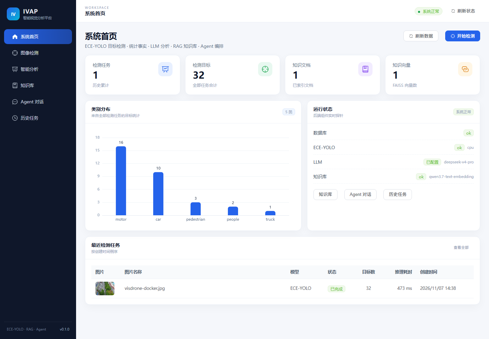
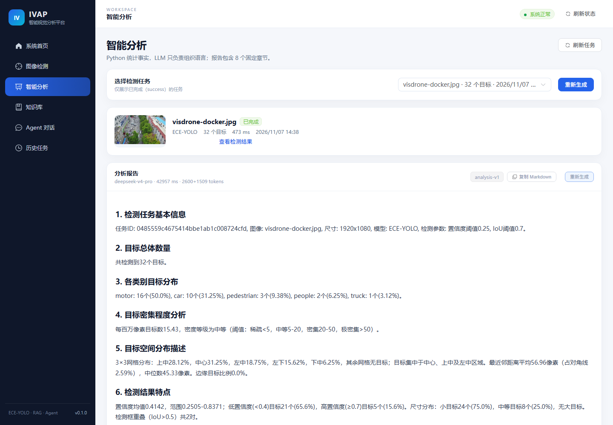
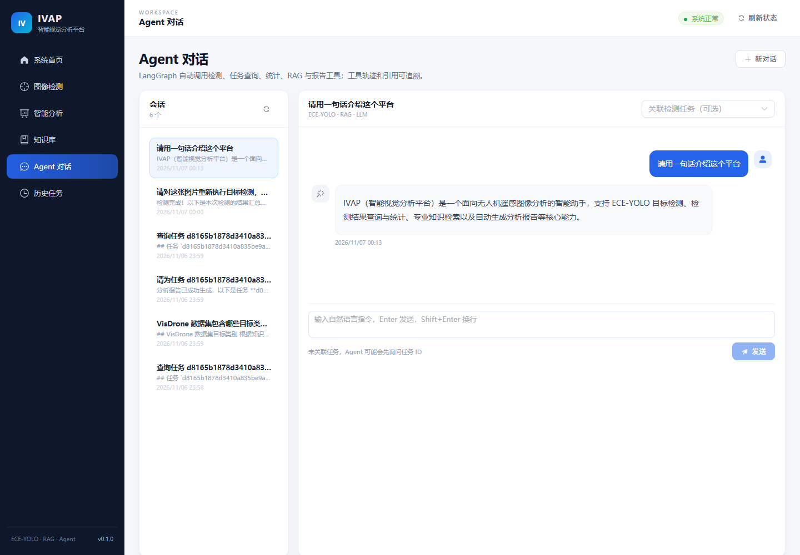

# 智能视觉分析平台（IVAP）

> 基于 **YOLO + LLM + RAG + Agent** 的无人机遥感图像智能视觉分析平台
>
> Intelligent Vision Analysis Platform

当前状态：**P8 完成**（Docker Desktop 4.98 + WSL2，三容器全部 healthy；真实检测、RAG、Agent、分析报告与数据卷持久化已验收）。
项目 P1–P8 全部完成。

> 快速阅读：[开发全流程](docs/12-full-development-record.md) · [归档与交接](docs/13-handover-and-archive.md) · [部署指南](docs/10-deployment.md) · [GitHub 上传步骤](GITHUB_UPLOAD.md) · [简历项目写法](docs/14-resume-bullets.md)

---

## 0. 项目截图与亮点







**核心亮点**

- **端到端可运行**：Vue 3 六页面 + FastAPI + MySQL + ECE-YOLO + LLM + RAG + LangGraph Agent + Docker Compose。
- **真实检测不是 Demo 数字**：ECE-YOLO 自定义模块接入，10 类；RTX 2060 预热后单图推理约 47 ms，CPU 路径约 0.5 s。
- **统计事实由 Python 计算**：LLM 只做 8 段报告组织；数量、密度、空间分布、置信度、IoU 均由 `stats.py` 计算，禁止模型改数字。
- **RAG 可追溯**：qwen3.7 1024 维 Embedding + FAISS，回答保留 `[S1]` 文档/页码引用；无依据时返回 `no_answer`。
- **Agent 可观测**：LangGraph 5 工具、最多 6 轮、180 s 超时；工具失败作为消息返回，不伪造结果；会话/工具轨迹/引用落库。
- **工程化交付**：45 个后端测试、ruff、Alembic、前端生产构建、3 容器 healthy、数据卷 down/up 持久化。

---

## 1. 项目能做什么（目标能力）

1. 上传无人机遥感图片，调用真实 ECE-YOLO 权重完成目标检测。
2. 展示检测框、类别、置信度，统计各类别数量与空间分布。
3. 保存检测历史，支持查询、详情、删除。
4. 调用 OpenAI 兼容 LLM，根据检测统计生成 8 段中文分析报告。
5. 上传 PDF / DOCX / TXT 构建 RAG 知识库，回答专业问题并给出文档、页码、片段来源。
6. 通过 LangGraph Agent 用自然语言调用检测、数据库、知识库、报告工具。
7. 通过 Swagger 调试接口，通过 Docker Compose 部署。

> **统计事实由 Python 计算，LLM 只负责组织语言**；缺少依据时明确说明，不编造数量、mAP 或实验数据。
> Mock 模式（`DETECTOR_MODE=mock` / `LLM_MOCK=true`）会在响应中标记 `is_mock=true`，不会冒充真实结果。

---

## 2. 当前进度

| 阶段 | 内容 | 状态 |
|---|---|---|
| P1 | 项目骨架、配置、日志、异常、健康检查、pytest | ✅ 已完成 |
| P2 | MySQL + SQLAlchemy + 任务 CRUD + 图片上传 | ✅ 已完成 |
| P3 | ECE-YOLO 模型接入、推理、绘图、检测 API | ✅ 已完成 |
| P4 | LLM 分析报告 | ✅ 已完成 |
| P5 | RAG 知识库（PDF/DOCX/TXT + FAISS） | ✅ 已完成 |
| P6 | LangGraph Agent 与 5 个工具 | ✅ 已完成 |
| P7 | Vue 3 前端 6 个页面 | ✅ 已完成 |
| P8 | 测试、Docker、部署文档 | ✅ 已完成 |

---

## 3. 技术栈

- **后端**：Python 3.9、FastAPI 0.115、Uvicorn、Pydantic v2、SQLAlchemy 2.0、Alembic
- **视觉**：PyTorch 2.1.2+cu118、Ultralytics 8.3.209、OpenCV 4.11、Pillow
- **数据库**：MySQL 8.0（生产）/ SQLite（测试）
- **LLM**：OpenAI 兼容接口，JSON mode + tool calling
- **RAG**：LangChain 切分 + PyMuPDF/python-docx + Embedding + FAISS
- **Agent**：LangGraph StateGraph
- **前端（P7）**：Vue 3.5、Vite 6、Element Plus 2.9、Pinia、ECharts 5.6
- **部署（P8）**：Docker、Docker Compose、Nginx

---

## 4. 目录结构

```text
D:\ECE-yolo-project\
├── best.pt                     # ECE-YOLO 权重（本地文件，已被 .gitignore 忽略）
├── backend/
│   ├── app/
│   │   ├── main.py             # 应用工厂 / lifespan / CORS / 静态目录
│   │   ├── api/v1/             # 路由层（health / detection）
│   │   ├── core/               # 配置、日志、异常、中间件、密码哈希
│   │   ├── schemas/            # Pydantic 契约
│   │   ├── models/             # ORM：8 张表
│   │   ├── db/                 # Base / Session / 迁移辅助
│   │   ├── services/           # storage / detection_service
│   │   ├── algorithms/         # 模型适配器（P3）
│   │   │   └── ece_yolo/vendor # 三个 ECE 自定义模块（源码副本）
│   │   ├── rag/                # 知识库（P5）
│   │   └── agents/             # Agent（P6）
│   ├── alembic/                # 迁移脚本
│   ├── tests/                  # pytest
│   ├── uploads/                # 原图、结果图、文档
│   ├── vector_db/              # FAISS 索引
│   ├── logs/                   # 滚动日志
│   └── pytest.ini
├── .mysql/                     # 本地 MySQL 8.0.28（gitignore）
├── scripts/                    # 启动/停止 MySQL、启动后端
├── frontend/                   # Vue 3 + Vite + Element Plus
│   ├── src/api/                # Axios 接口
│   ├── src/components/         # 布局、上传、检测查看器、图表、Markdown、引用
│   ├── src/views/              # 6 个页面
│   └── src/stores/             # Pinia
├── docs/
│   └── 01-architecture-design.md
├── requirements.txt
├── requirements-vision.txt
├── requirements-dev.txt
├── .env.example
├── .gitignore
└── README.md
```

---

## 5. 快速开始（Windows PowerShell 5.1）

### 5.1 环境说明

本项目**复用** `D:\Anaconda\envs\py39` 的 GPU 环境，但所有新依赖只安装到项目 `.venv`，不会改动原环境：

- Python 3.9.21
- torch 2.1.2+cu118 / torchvision 0.16.2
- OpenCV 4.11.0 / Ultralytics 8.3.209
- CUDA 可用（RTX 2060 6 GB）

> 本机 PowerShell 执行策略禁止 `.ps1`，因此不要使用 `Activate.ps1` 或 `npm.ps1`；直接调用 `.venv\Scripts\python.exe`，npm 用 `npm.cmd`。

### 5.2 创建环境

```powershell
cd D:\ECE-yolo-project

D:\Anaconda\envs\py39\python.exe -m venv .venv --system-site-packages
.\.venv\Scripts\python.exe -m pip install --upgrade pip

# 验证 GPU 栈
.\.venv\Scripts\python.exe -c "import torch, cv2, ultralytics; print(torch.__version__, torch.cuda.is_available(), cv2.__version__, ultralytics.__version__)"

# 安装项目依赖
.\.venv\Scripts\python.exe -m pip install -r requirements.txt -r requirements-dev.txt
```

### 5.3 配置

```powershell
Copy-Item .env.example .env
# 至少修改 DATABASE_URL：
# mysql+pymysql://ivap:<password>@127.0.0.1:3306/ivap?charset=utf8mb4
```

本机已生成 `.env`（MySQL 专用用户、随机密码），`.env` 已被 `.gitignore` 忽略。
P2 起需要 MySQL；数据库不可用时 `/health` 会显示 `degraded`，但服务仍可启动。

### 5.4 启动 MySQL（本机便携实例）

本机没有管理员权限，因此使用 MySQL 8.0.28 免安装 ZIP，数据目录在 `.mysql\data`，只监听 `127.0.0.1:3306`。

```powershell
# 新开一个终端，保持运行
D:\ECE-yolo-project\scripts\mysql_start.cmd

# 另开终端检查
D:\ECE-yolo-project\scripts\mysql_status.cmd
```

- root / 应用用户密码：`.mysql\credentials.txt`（本机文件，不提交 Git）
- 停止：`scripts\mysql_stop.cmd`
- 若你已安装 MySQL 8.0 系统服务，改 `.env` 的 `DATABASE_URL` 即可，不必使用便携实例

### 5.5 执行数据库迁移

```powershell
cd D:\ECE-yolo-project\backend
..\.venv\Scripts\python.exe -m alembic -c alembic.ini upgrade head
..\.venv\Scripts\python.exe -m alembic -c alembic.ini current
```

应输出 `715d6a5194fc (head)`。

### 5.6 启动后端

```powershell
cd D:\ECE-yolo-project
.\.venv\Scripts\python.exe -m uvicorn app.main:app --app-dir backend --host 127.0.0.1 --port 8000 --reload

# 或使用脚本
scripts\run_backend.cmd
```

打开：

- Swagger：<http://127.0.0.1:8000/docs>
- 健康检查：<http://127.0.0.1:8000/api/v1/health>
- 容器探针别名：<http://127.0.0.1:8000/health>

### 5.7 前端

```powershell
cd D:\ECE-yolo-project\frontend
D:\nodejs\npm.cmd install --registry=https://registry.npmmirror.com
D:\nodejs\npm.cmd run dev
```

打开 <http://127.0.0.1:5173>。Vite 已配置 `/api` 与 `/static` 代理到 `127.0.0.1:8000`。

### 5.8 Docker Compose（P8）

前置：Docker Desktop 4.98 + WSL2，已安装到 `D:\Docker`，数据盘 `D:\DockerData`。

```powershell
Copy-Item .env.docker.example .env.docker
# 填写 .env.docker 中的 MySQL/LLM/Embedding 密钥
docker compose --env-file .env.docker up -d --build
```

- 前端：<http://localhost:8080>
- Swagger：<http://localhost:8000/docs>
- GPU：`docker compose --env-file .env.docker -f docker-compose.yml -f docker-compose.gpu.yml up -d --build`

当前本机已运行：

```text
ivap-mysql     healthy   localhost:3307
ivap-backend   healthy   localhost:8000
ivap-frontend  healthy   localhost:8080
```

实测常驻内存约：backend 350–450 MB、MySQL 360–405 MB、Nginx 8–10 MB；Docker WSL2 虚拟机空闲约 1.7 GB。WSL 限制为 8 GB / 8 核 / 2 GB swap。

详见 [部署指南](docs/10-deployment.md)。

### 5.9 测试

```powershell
cd backend
..\.venv\Scripts\python.exe -m pytest -q
..\.venv\Scripts\python.exe -m ruff check .
```

测试使用临时 SQLite 与临时上传目录，不会污染 MySQL / `backend/uploads`。

---

## 6. API（P1/P2）

| 方法 | 路径 | 说明 |
|---|---|---|
| GET | `/api/v1/health` | 健康检查（数据库/模型/LLM/向量库状态） |
| POST | `/api/v1/detection/predict` | **真实 ECE-YOLO 推理**，写目标明细/统计/结果图 |
| POST | `/api/v1/detection/upload` | 上传图片并创建 `pending` 任务（不推理） |
| GET | `/api/v1/detection/tasks` | 任务分页/关键词/状态/模型/时间筛选 |
| GET | `/api/v1/detection/tasks/{task_id}` | 任务详情（含目标框） |
| DELETE | `/api/v1/detection/tasks/{task_id}` | 删除任务、目标明细与图片 |
| GET | `/api/v1/detection/models` | 模型配置与就绪状态 |
| GET | `/api/v1/detection/overview` | 首页统计（任务数/目标数/类别分布） |
| POST | `/api/v1/analysis/{task_id}` | 生成 8 段 LLM 分析报告 |
| GET | `/api/v1/analysis/{task_id}` | 查询最新报告 |
| POST | `/api/v1/knowledge/upload` | 上传并索引 PDF/DOCX/TXT |
| GET | `/api/v1/knowledge/documents` | 文档分页列表 |
| DELETE | `/api/v1/knowledge/documents/{document_id}` | 删除文档与向量 |
| POST | `/api/v1/knowledge/search` | 相似度检索（带来源） |
| POST | `/api/v1/knowledge/ask` | 基于知识库回答并返回引用 |
| POST | `/api/v1/chat` | LangGraph Agent 对话（自动调用工具） |
| GET | `/api/v1/chat/history` | 会话列表 / 某个会话消息 |
| GET | `/health` | 容器探针别名（不在 OpenAPI 中） |
| GET | `/` | 项目信息与文档链接 |
| GET | `/docs` / `/openapi.json` | Swagger / OpenAPI |

上传示例：

```powershell
curl.exe -X POST "http://127.0.0.1:8000/api/v1/detection/predict" -F "file=@D:\path\uav.jpg"
```

```json
{
  "task_id": "ba0a39dca8794effaeae201c9d84c6c3",
  "status": "success",
  "image_name": "uav.jpg",
  "model_name": "ECE-YOLO",
  "total_objects": 33,
  "inference_time_ms": 47,
  "class_statistics": {"motor": 17, "car": 11, "people": 2, "pedestrian": 2, "truck": 1},
  "result_image": "/static/results/2026/11/ba0a39dca8794effaeae201c9d84c6c3.jpg",
  "detections": [
    {"class_id": 3, "class_name": "car", "confidence": 0.8414, "bbox": [949, 591, 1012, 684]}
  ],
  "created_at": "2026-11-06T15:23:20.000Z"
}
```

健康检查示例（MySQL 已连接）：

```json
{
  "status": "ok",
  "app": "Intelligent Vision Analysis Platform",
  "version": "0.1.0",
  "environment": "development",
  "time": "2026-11-06T12:00:00.000Z",
  "components": {
    "database": {"status": "ok", "detail": null, "dialect": "mysql"},
    "detector": {"status": "ok", "detail": null, "model": "ECE-YOLO", "loaded": true, "device": "cuda:0", "mock": false},
    "llm": {"configured": true, "model": "deepseek-v4-pro"},
    "vector_store": {"status": "ok", "detail": null, "documents": 3, "vectors": 4, "embedding_model": "qwen3.7-text-embedding"}
  }
}
```

统一错误体：

```json
{
  "error": {
    "code": "NOT_FOUND",
    "message": "Not Found",
    "details": null,
    "request_id": "c9f0f8d2a1b34e8e9a7d6c5b4a3f2e1d"
  }
}
```

---

## 7. 配置项

完整模板见 [.env.example](.env.example)。关键项：

| 变量 | 说明 |
|---|---|
| `APP_ENV` | `development` / `testing` / `production` |
| `DATABASE_URL` | MySQL 连接串（测试使用临时 SQLite） |
| `MODELS_CONFIG` | 模型注册表 `backend/config/models.yaml`（P3） |
| `DEFAULT_MODEL` | 默认模型，当前为 `ece-yolo` |
| `DETECTOR_MODE` | `real` / `mock`，mock 会标记 `is_mock` |
| `LLM_API_KEY` / `LLM_BASE_URL` / `LLM_MODEL` | OpenAI 兼容服务 |
| `LLM_MAX_TOKENS` / `LLM_TIMEOUT_SECONDS` | 报告 token 预算与超时（当前 4000 / 120） |
| `LLM_MOCK` | `true` 时生成明确标识的 Mock 报告 |
| `EMBEDDING_*` | Embedding 服务与维度 |
| `RAG_*` | Top-K、阈值、切分参数 |
| `AGENT_MAX_STEPS` / `AGENT_TIMEOUT_SECONDS` | Agent 最多工具轮数 / 超时（默认 6 / 180s） |
| `UPLOAD_DIR` / `VECTOR_DB_DIR` / `LOG_DIR` | 运行时目录 |

---

## 8. ECE-YOLO 权重与自定义模块

`best.pt` 已放在项目根目录（4.68 MB，Ultralytics checkpoint 格式）。2026-11-06 已在本机 CPU 与 RTX 2060 上完成加载与推理冒烟验证。

checkpoint 实际信息：

- `nc=10`，类别：pedestrian / people / bicycle / car / van / truck / tricycle / awning-tricycle / bus / motor
- `stride=[8, 16, 32]`
- 训练参数：`imgsz=640`、`conf=None`、`iou=0.7`
- checkpoint 记录的验证指标：mAP50=0.37453、mAP50-95=0.22325（真实训练记录，不是本项目编造）

自定义模块（来自 `D:\yolo11（2）\ultralytics-main\ultralytics\nn\Addmodules\`）：

- `ESPMStem`
- `RepNCSPELAN4_low`
- `DynamicHead`（依赖 `mmcv.ops.ModulatedDeformConv2d`）

本机没有 mmcv，因此验证时使用 `torchvision.ops.deform_conv2d` 做了进程内兼容层；按 mmcv 的输出尺寸规则裁剪 offset 后，模型可在 CPU/GPU 上正常检出目标（VisDrone 验证图约 33 个目标，CPU/GPU 框一致）。

> 当前状态：**已接入业务代码（P3）**。兼容层、模块注册、Detector 适配器位于 `backend/app/algorithms/ece_yolo/`，模型由 `ModelManager` 单例加载，启动时预热。
>
> 实测（RTX 2060，VisDrone 验证图）：33 个目标（car 11 / motor 17 / truck 1 / people 2 / pedestrian 2），预热后首次推理 296 ms、第二次 47 ms；CPU 推理约 507 ms。结果图与 33 条目标明细均落库。
>
> 默认值：`imgsz=640`、`conf=0.25`、`iou=0.7`。详见 [P3 实施报告](docs/05-phase-3-report.md)。

---

## 9. 设计文档

- [系统架构与第一阶段实施方案](docs/01-architecture-design.md)
- [第一阶段实施报告（P1）](docs/02-phase-1-report.md)
- [ECE-YOLO 接入验证记录](docs/03-ece-yolo-integration-notes.md)
- [第二阶段实施报告（P2）](docs/04-phase-2-report.md)
- [第三阶段实施报告（P3）](docs/05-phase-3-report.md)
- [第四阶段实施报告（P4）](docs/06-phase-4-report.md)
- [第五阶段实施报告（P5）](docs/07-phase-5-report.md)
- [第六阶段实施报告（P6）](docs/08-phase-6-report.md)
- [第七阶段实施报告（P7）](docs/09-phase-7-report.md)
- [Docker / Compose 部署指南](docs/10-deployment.md)
- [第八阶段实施报告（P8）](docs/11-phase-8-report.md)
- [开发全流程总记录](docs/12-full-development-record.md)
- [归档与交接说明](docs/13-handover-and-archive.md)
- [简历项目写法](docs/14-resume-bullets.md)
- [GitHub 上传步骤](GITHUB_UPLOAD.md)

包含：总体架构、技术选型、模块依赖、数据库表、17 个 API 契约、RAG/Agent 设计、环境检查、阶段计划、风险登记；以及 P1–P8 的实际命令、测试输出与问题处理。

---

## 10. 安全约定

- 不把 API Key、数据库密码写入代码或 Git；只放在本机 `.env`。
- 上传文件做类型、magic bytes、大小、路径穿越校验。
- Markdown 渲染必须经 DOMPurify；错误响应生产环境不返回堆栈。
- 密码使用 PBKDF2-HMAC-SHA256（P2 实现）。
