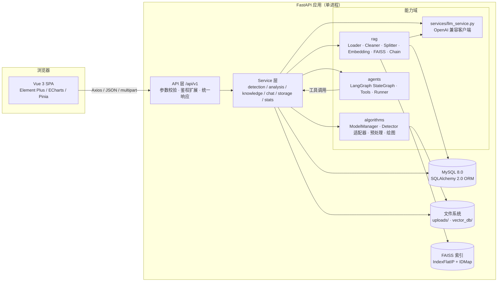
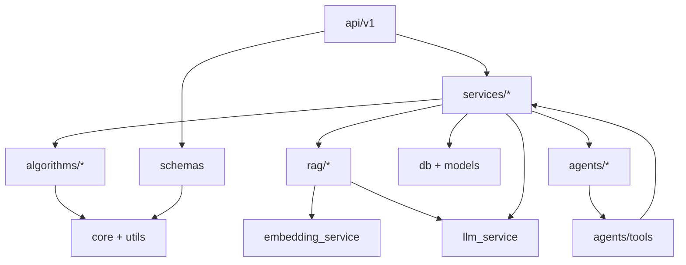
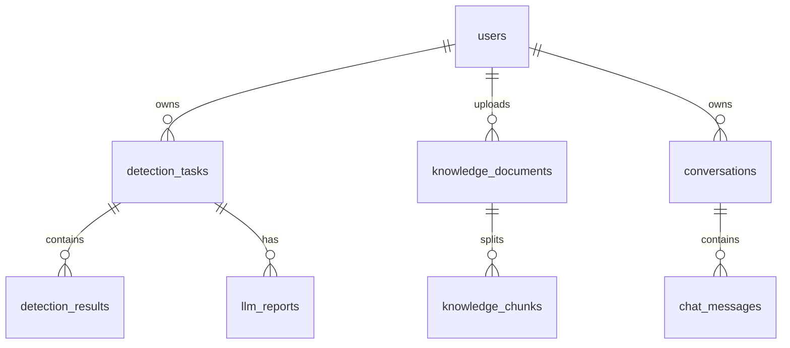

# 智能视觉分析平台 — 系统架构设计与第一阶段实施方案

> 项目代号：IVAP（Intelligent Vision Analysis Platform）
> 文档版本：v0.1（设计评审稿）
> 编写日期：2026-11-06
> 状态：**待确认**。确认后按第十一章的阶段顺序开发，不一次性生成全部代码。

---

## 0. 结论摘要（TL;DR）

1. **架构**：前后端分离的模块化单体。Vue 3 SPA → FastAPI（`/api/v1`）→ Service 层 → 算法 / LLM / RAG / Agent 四个能力域 → MySQL + 文件系统 + FAISS。路由层不写业务，能力域之间通过明确的 Service 接口调用。
2. **环境**：当前机器可以直接开始第一阶段。已确认 Python 3.9.21、PyTorch 2.1.2+cu118、CUDA 可用（RTX 2060 6 GB）、Ultralytics 8.3.209、FastAPI 0.115.12、Node 24.21.0、Git 2.54。
3. **关键缺口**：本机**没有 MySQL、没有 Docker、没有 LLM API Key**。ECE-YOLO 权重与自定义模块已提供并完成 CPU 冒烟验证；剩余风险是 torchvision 兼容层与真实 mmcv 的数值一致性。MySQL/Docker/LLM 分别阻塞第二阶段、第八阶段、第四阶段。
4. **环境策略**：**不修改** `D:\Anaconda\envs\py39`（疑似现有算法环境，11.3 GB）。以它为 base 创建项目独立 venv，并开启 `--system-site-packages` 复用 torch / torchvision / OpenCV / Ultralytics，新依赖只装进项目 venv。
5. **第一阶段**：只做“可启动、可测试、有健康检查”的 FastAPI 骨架，不接数据库、不接模型、不接 LLM。预计 0.5 天，验收标准见第 12.7 节。

**需要你确认的 4 件事**（详见第十四章）：

- 是否按本设计进入第一阶段；
- MySQL 是先安装，还是第二阶段先用 SQLite 开发、验收时再切 MySQL；
- ECE-YOLO 推理默认参数是否按 `conf=0.25 / iou=0.7 / imgsz=640` 固定；
- LLM 与 Embedding 使用哪家 OpenAI 兼容服务。

---

## 1. 需求理解与范围

### 1.1 项目目标

面向无人机遥感图像，构建一个“上传图片 → 真实 YOLO 检测 → 统计与可视化 → LLM 生成分析报告 → RAG 专业问答 → Agent 自动编排”的完整 Web 系统，并具备数据库、API 文档、日志、异常处理、自动化测试和 Docker 部署能力。

### 1.2 核心用户流程

```text
① 检测流程
   上传图片 → 校验/落盘 → 模型推理 → 绘制结果图 → 写任务与目标明细 → 返回 JSON → 前端可视化

② 分析流程
   选择检测任务 → Python 计算统计事实 → 构造 Prompt → LLM 生成 8 段报告 → 校验结构 → 入库 → 前端 Markdown 展示

③ 知识库流程
   上传 PDF/DOCX/TXT → 解析（保留页码）→ 清洗 → 切分 → Embedding → FAISS → 检索 → 带引用回答

④ Agent 流程
   自然语言 → LangGraph 状态机 → 选择工具 → 执行（检测/查库/RAG/报告）→ 汇总 → 返回答案 + 工具轨迹 + 引用
```

### 1.3 本期范围

- 单机、单进程部署；单用户/演示用户（`users` 表与密码哈希保留，登录鉴权作为扩展，不阻塞主流程）。
- 图片目标检测（JPG/JPEG/PNG），不做视频流、不做实时摄像头。
- PDF / DOCX / TXT 知识库；扫描版 PDF 的 OCR **不在本期**（会明确报错，不静默失败）。
- LLM 分析基于检测统计事实，不把原图直接送给多模态模型。
- Docker Compose 单机部署，默认 CPU 后端；GPU 作为可选覆盖配置。

### 1.4 明确不做（防止范围蔓延）

- 模型训练、蒸馏、超参搜索；
- 多租户、RBAC 权限体系、审计合规；
- 分布式向量库、消息队列、K8s；
- 前端移动端适配；
- 真实 mAP / 推理 benchmark 的自动生成（没有实验数据就不写）。

### 1.5 不可违背的硬约束

| 约束 | 落地方式 |
|---|---|
| 数量统计必须由 Python 计算 | `services/stats.py` 输出 `class_statistics`，LLM 只拿结果，不数数 |
| 空间统计必须基于真实坐标 | 由 bbox 计算 3×3 网格、密度、最近邻、边缘比例、尺寸分布 |
| 不允许 LLM 编造数量/性能/实验数据 | Prompt 白名单事实 + 结构化输出校验 + 报告只使用 facts |
| 模型可配置、不得与某一权重强耦合 | `algorithms/registry.py` + `config/models.yaml` + 适配器协议 |
| 不得每次请求重新加载模型 | `ModelManager` 单例，应用 lifespan 初始化，按模型名缓存 |
| API Key / 数据库密码不得硬编码 | `pydantic-settings` 从 `.env` / 环境变量读取，`SecretStr` |
| Mock 必须可识别 | 响应含 `is_mock: true`，前端显著横幅，日志 WARNING |
| Python 3.9 | 所有依赖锁定在支持 3.9 的区间，安装后生成 lock 文件 |

---

## 2. 总体架构

### 2.1 架构图



### 2.2 分层职责

| 层 | 目录 | 职责 | 禁止 |
|---|---|---|---|
| 路由层 | `app/api/v1/` | 解析请求、校验参数、调用 Service、返回 Schema、HTTP 状态码 | 写 SQL、加载模型、拼 Prompt |
| 服务层 | `app/services/` | 业务编排、事务边界、文件生命周期、统计计算 | 直接依赖 FastAPI Request |
| 能力层 | `app/algorithms/` `app/rag/` `app/agents/` | 模型推理、RAG 管线、Agent 状态机 | 直接返回 HTTP 响应 |
| 数据层 | `app/models/` `app/db/` | ORM 模型、会话、迁移 | 写业务判断 |
| 基础设施 | `app/core/` | 配置、日志、异常、中间件、安全工具 | 承载业务 |
| 前端 | `frontend/src/` | 交互、展示、图表、Markdown、引用 | 直接计算检测数量（以后端为准） |

### 2.3 请求生命周期（以图片检测为例）

```text
POST /api/v1/detection/predict
  → RequestIDMiddleware 注入 request_id / 计时
  → 路由校验 multipart（大小、扩展名、magic bytes、Pillow 可解码）
  → StorageService 保存原图（按年月分目录，UUID 文件名）
  → DetectionService:
      1) 创建 task(status=running) 并提交，保证失败也有记录
      2) ModelManager.get(model_name)（已加载则直接复用）
      3) 在专用线程池中执行推理（GPU 串行）
      4) 结果写 detection_results + 更新 task(status=success)
      5) 绘制结果图，写 static 目录
  → 返回 DetectionResponse（字段与任务书一致）
异常：task 置 failed + error_message，返回统一错误体，不泄漏堆栈
```

### 2.4 部署形态

```text
开发：Windows 本机
      uvicorn :8000（单 worker）  +  Vite dev server :5173（/api 代理到 8000）

生产：docker compose
      nginx :80（静态 SPA + /api、/static 反代）
      backend :8000（uvicorn 单 worker）
      mysql :3306（utf8mb4，持久化卷）
      可选 GPU overlay：NVIDIA Container Toolkit
```

> **单进程约束**：YOLO 权重、FAISS 索引都驻留进程内存。`uvicorn --workers` 必须为 1，否则多进程各自持有模型与索引，会出现状态不一致。需要横向扩展时，应把模型服务与向量库外置，属于后续演进，不在本期。

---

## 3. 技术选型

### 3.1 后端

| 组件 | 选型 | 版本策略 | 理由 |
|---|---|---|---|
| 语言 | Python | **3.9.21**（复用 `envs/py39`） | 与现有算法环境一致，避免升级破坏 |
| Web 框架 | FastAPI | `>=0.115,<0.116` | 异步、Pydantic v2、自动 OpenAPI |
| ASGI | Uvicorn | `>=0.30,<0.35` | 标准部署，`--reload` 开发友好 |
| 校验 | Pydantic v2 | `>=2.9,<3` | 请求/响应/配置统一模型 |
| 配置 | pydantic-settings | `>=2.5,<3` | `.env` + 环境变量，SecretStr |
| ORM | SQLAlchemy 2.0 | `>=2.0.30,<2.1` | 2.0 风格 `select()`、事务清晰 |
| 驱动 | PyMySQL | `>=1.1,<2` | 纯 Python，Windows 无需编译 |
| 迁移 | Alembic | `>=1.13,<2` | 表结构版本化，Docker 启动可升级 |
| 日志 | 标准库 logging | — | 无额外依赖，RotatingFileHandler + JSON 可选 |

### 3.2 视觉算法

| 组件 | 选型 | 版本 | 说明 |
|---|---|---|---|
| 深度学习 | PyTorch | **2.1.2+cu118**（已装） | 不升级；RTX 2060 6 GB |
| 检测框架 | Ultralytics | **8.3.209**（已装） | 作为默认适配器；YOLO26 权重需实测兼容性 |
| 图像处理 | OpenCV | **4.11.0**（已装） | 读写、颜色、几何 |
| 绘图/字体 | Pillow | `>=10,<11` | 支持中文类别名；OpenCV 只负责画框 |
| 数组 | NumPy | `>=1.26,<2` | **必须 <2**，否则 torch 2.1.2 可能 ABI 不兼容 |

### 3.3 LLM / RAG / Agent

| 组件 | 选型 | 版本策略 | 说明 |
|---|---|---|---|
| LLM 协议 | OpenAI 兼容 HTTP | `openai>=1.40,<2` | Base URL / Key / Model / Timeout 全部可配 |
| 结构化输出 | JSON mode + Pydantic 校验 | — | 不依赖某家厂商的 `json_schema` 支持 |
| 文档解析 | PyMuPDF | `>=1.24,<1.27` | PDF 按页抽取，保留页码 |
| DOCX | python-docx | `>=1.1,<2` | 段落 + 表格；Word 无稳定页码，标注段落号 |
| 文本切分 | LangChain Text Splitters | `langchain>=0.3,<0.4` | 递归字符切分，中文分隔符 |
| 向量库 | FAISS | `faiss-cpu>=1.8,<1.10` | `IndexFlatIP` + 归一化 = 余弦相似度 |
| 工作流 | LangGraph | `>=0.2.60,<0.4` | `StateGraph` + 条件边 + 工具循环 |
| Embedding | OpenAI 兼容 / 本地 BGE（可选） | — | 默认 API；离线场景可切 `sentence-transformers` |

> **为什么 Embedding 不默认用 LangChain 的 `OpenAIEmbeddings`**：部分国产兼容网关对 `encoding_format=base64`、`dimensions` 参数支持不一致。项目内用 `openai` SDK 直接调用 `/embeddings`，参数可控、错误可诊断；LangChain 仍用于切分、Prompt 与文档抽象。

### 3.4 前端

| 组件 | 选型 | 版本策略 | 说明 |
|---|---|---|---|
| 框架 | Vue 3 | `^3.5` | `<script setup>` |
| 构建 | Vite | `^6.0` | Node 24 兼容，生态稳定 |
| UI | Element Plus | `^2.9` | 表格、上传、对话框、消息 |
| 状态 | Pinia | `^2.3` | 按业务域拆分 store |
| 路由 | Vue Router | `^4.5` | History 模式 |
| HTTP | Axios | `^1.8` | 统一拦截器、错误提示 |
| 图表 | ECharts | `^5.6` | 按需引入，减小包体 |
| Markdown | markdown-it + DOMPurify | `^14` / `^3` | 必须 sanitize，防 XSS |
| 语言 | JavaScript（非 TS） | — | 降低前端门槛；接口类型用 JSDoc 注释 |

### 3.5 数据库与部署

| 组件 | 选型 | 说明 |
|---|---|---|
| 数据库 | MySQL 8.0 | 开发与生产一致；测试用 SQLite |
| 容器 | Docker + Compose | 第八阶段；当前机器未安装 |
| 反向代理 | Nginx Alpine | 静态资源 + API 代理 |
| 版本控制 | Git | 当前工作区尚未 `git init` |

### 3.6 版本策略

1. `requirements.txt` 写**兼容区间**，不用 `==` 锁死所有传递依赖。
2. 第一阶段安装成功后执行 `pip list --local --format=freeze | Set-Content -Encoding ASCII requirements.lock.txt`，得到 **venv 内新增依赖**的精确版本；torch/torchvision/OpenCV/Ultralytics 的版本记录在 `requirements-vision.txt` 与本文第 10 章，不重复锁定。
3. 任何依赖升级必须满足：Python 3.9、torch 2.1.2 不变、`numpy<2`、CUDA 11.8 可用。
4. 绝不因安装新包而升级/卸载 `D:\Anaconda\envs\py39` 中的既有包。

---

## 4. 模块划分与依赖关系

### 4.1 后端目标目录（标注第一阶段创建）

```text
backend/
├── app/
│   ├── main.py                        # [P1] 应用工厂、lifespan、CORS、静态目录、路由挂载
│   ├── api/
│   │   ├── deps.py                    # [P2] DB Session、当前用户、Service 依赖
│   │   └── v1/
│   │       ├── router.py              # [P1] 汇总 v1 路由
│   │       └── endpoints/
│   │           ├── health.py          # [P1] 健康检查
│   │           ├── detection.py       # [P2/P3] 检测、任务列表/详情/删除
│   │           ├── analysis.py        # [P4] 报告生成/查询
│   │           ├── knowledge.py       # [P5] 上传/列表/删除/检索
│   │           └── chat.py            # [P6] 对话/历史
│   ├── core/
│   │   ├── config.py                  # [P1] 配置单例、路径解析
│   │   ├── logging.py                 # [P1] 控制台+滚动文件、request_id 过滤器
│   │   ├── exceptions.py              # [P1] AppError 体系与全局处理器
│   │   ├── middleware.py              # [P1] RequestID、耗时、访问日志
│   │   └── security.py                # [P2] PBKDF2 密码哈希（预留 JWT）
│   ├── db/
│   │   ├── base.py                    # [P2] Declarative Base、命名约定
│   │   ├── session.py                 # [P2] engine / SessionLocal / get_db
│   │   └── init_db.py                 # [P2] 建表/种子数据（开发）
│   ├── models/
│   │   ├── user.py                    # [P2]
│   │   ├── detection.py               # [P2] detection_tasks + detection_results
│   │   ├── report.py                  # [P2]
│   │   ├── knowledge.py               # [P2] documents + chunks
│   │   └── chat.py                    # [P2] conversations + messages
│   ├── schemas/
│   │   ├── common.py                  # [P1] 分页、错误体、响应基类
│   │   ├── health.py                  # [P1]
│   │   ├── detection.py               # [P2/P3]
│   │   ├── analysis.py                # [P4]
│   │   ├── knowledge.py               # [P5]
│   │   └── chat.py                    # [P6]
│   ├── services/
│   │   ├── storage.py                 # [P2] 文件保存/删除/URL 生成/路径安全
│   │   ├── detection_service.py       # [P3] 检测编排、任务 CRUD
│   │   ├── stats.py                   # [P3] 类别/空间统计（纯函数，可单测）
│   │   ├── llm_service.py             # [P4] LLM 客户端封装
│   │   ├── analysis_service.py        # [P4] 报告生成、Prompt、校验、入库
│   │   ├── embedding_service.py       # [P5] 向量化
│   │   ├── knowledge_service.py       # [P5] 文档生命周期、检索
│   │   └── chat_service.py            # [P6] 对话持久化、Agent 编排
│   ├── algorithms/
│   │   ├── base.py                    # [P3] Detector 协议、Detection 数据类
│   │   ├── registry.py                # [P3] 适配器注册/工厂
│   │   ├── model_manager.py           # [P3] 单例缓存、锁、设备管理
│   │   ├── ultralytics_detector.py    # [P3] Ultralytics 适配器
│   │   ├── custom_torch_detector.py   # [P3] ECE-YOLO 等自定义入口模板
│   │   ├── mock_detector.py           # [P3] 明确标识的 Mock
│   │   ├── preprocess.py              # [P3] EXIF/尺寸/归一化
│   │   └── visualize.py               # [P3] PIL 画框与中文标签
│   ├── rag/
│   │   ├── loaders.py                 # [P5] PDF/DOCX/TXT → 带页码的文本块
│   │   ├── cleaner.py                 # [P5] 空白/控制字符/页眉页脚清理
│   │   ├── splitter.py                # [P5] 递归切分 + 元数据
│   │   ├── embeddings.py              # [P5] Embedding 适配
│   │   ├── vector_store.py            # [P5] FAISS 持久化、增删/重建
│   │   ├── retriever.py               # [P5] 检索 + 阈值 + 引用
│   │   ├── prompts.py                 # [P5] RAG Prompt 模板
│   │   └── chain.py                   # [P5] 检索→Prompt→LLM→引用
│   ├── agents/
│   │   ├── state.py                   # [P6] AgentState
│   │   ├── tools.py                   # [P6] 5 个工具 + 参数模型 + 注册表
│   │   ├── graph.py                   # [P6] LangGraph 工作流
│   │   ├── runner.py                  # [P6] 执行、超时、重试、轨迹
│   │   └── prompts.py                 # [P6] 系统提示词
│   └── utils/
│       ├── image.py                   # [P3] 图片读取/校验/尺寸
│       ├── files.py                   # [P2] 文件名/磁盘/哈希
│       ├── time.py                    # [P1] UTC 时间与 ISO 序列化
│       └── text.py                    # [P5] 文本截断/清洗
├── config/
│   └── models.yaml                    # [P3] 模型注册表
├── alembic/                           # [P2] 迁移脚本
├── tests/
│   ├── conftest.py                    # [P1] TestClient、临时目录、DB 覆盖
│   ├── test_health.py                 # [P1]
│   ├── test_detection_api.py          # [P3]
│   ├── test_stats.py                  # [P3]
│   ├── test_llm_analysis.py           # [P4]
│   ├── test_rag.py                    # [P5]
│   └── test_agent_tools.py            # [P6]
├── uploads/                           # 原图、结果图、文档（运行时）
├── vector_db/                         # FAISS 索引（运行时）
└── logs/                              # 滚动日志（运行时）
```

### 4.2 前端目标目录

```text
frontend/
├── index.html
├── package.json
├── vite.config.js                     # /api、/static 代理到后端
├── .env.development                   # VITE_API_BASE_URL=/api/v1
└── src/
    ├── main.js                        # Vue、Pinia、Router、Element Plus
    ├── App.vue
    ├── assets/styles/                 # 变量、全局样式、Element 主题覆盖
    ├── api/
    │   ├── http.js                    # Axios 实例 + 拦截器
    │   ├── detection.js
    │   ├── analysis.js
    │   ├── knowledge.js
    │   └── chat.js
    ├── router/index.js                # 6 个页面路由
    ├── stores/
    │   ├── app.js                     # 健康状态、全局配置
    │   ├── detection.js
    │   ├── knowledge.js
    │   └── chat.js
    ├── components/
    │   ├── AppLayout.vue
    │   ├── PageHeader.vue
    │   ├── StatCard.vue
    │   ├── UploadDropzone.vue
    │   ├── DetectionViewer.vue        # 结果图 + bbox 叠加 + 缩放
    │   ├── ClassBarChart.vue
    │   ├── TaskTable.vue
    │   ├── MarkdownView.vue           # markdown-it + DOMPurify
    │   ├── CitationList.vue
    │   ├── ToolCallList.vue
    │   └── EmptyState.vue
    └── views/
        ├── HomeView.vue
        ├── DetectView.vue
        ├── AnalysisView.vue
        ├── KnowledgeView.vue
        ├── AgentView.vue
        └── HistoryView.vue
```

### 4.3 依赖规则（必须遵守）

```text
api  →  services  →  algorithms / rag / agents / db / core
agents.tools  →  services（detection / analysis / knowledge）
rag  →  services.embedding_service, services.llm_service, db
algorithms  →  core, utils（不得 import services、api）
models  →  db.base（不得 import services）
schemas  →  core（不得 import models，避免 ORM 泄漏到 API 契约）
```

- `services/detection_service.py` **不得** import `agents`，避免循环依赖。
- Agent 工具不直接写 SQL，统一调用 Service。
- `schemas` 与 `models` 分离，API 契约不直接暴露 ORM 对象。
- 所有跨模块调用通过构造函数/参数注入，便于测试替换（尤其是模型与 LLM）。

### 4.4 模块依赖图



### 4.5 关键抽象（设计签名，第一阶段不实现）

```python
# algorithms/base.py
@dataclass(frozen=True)
class Detection:
    class_id: int
    class_name: str
    confidence: float
    bbox: tuple[int, int, int, int]   # x1, y1, x2, y2，原图像素坐标

class BaseDetector(Protocol):
    name: str
    display_name: str
    is_mock: bool
    def load(self) -> None: ...
    def predict(self, image: np.ndarray, conf: float, iou: float) -> list[Detection]: ...
    def warmup(self) -> None: ...
    def unload(self) -> None: ...

# services/llm_service.py
class LLMService:
    async def chat(self, messages, **kwargs) -> LLMResult: ...
    async def chat_json(self, messages, schema_hint: str, **kwargs) -> tuple[dict, LLMResult]: ...
    async def chat_with_tools(self, messages, tools) -> LLMMessage: ...

# rag/vector_store.py
class FaissVectorStore:
    def add(self, vectors: np.ndarray, chunk_ids: list[int]) -> None: ...
    def search(self, query_vector: np.ndarray, top_k: int) -> list[tuple[int, float]]: ...
    def remove_document(self, document_id: str) -> int: ...
    def save(self) -> None: ...
    def load(self) -> None: ...
```

---

## 5. 核心机制设计

### 5.1 模型管理与推理

**目标**：任意 Ultralytics 权重可配置接入；ECE-YOLO 等自定义模型通过适配器扩展；进程内只加载一次。

`backend/config/models.yaml` 草案：

```yaml
default: ece-yolo
models:
  ece-yolo:
    display_name: ECE-YOLO
    adapter: ece_yolo             # ece_yolo | ultralytics | custom_torch | mock
    weights: best.pt
    device: auto                  # auto | cpu | cuda:0
    imgsz: 640
    conf: 0.25
    iou: 0.7
    class_names: null             # null 表示从 checkpoint 读取（已确认 10 类）
  yolo26n:
    display_name: YOLO26n
    adapter: ultralytics
    weights: models/yolo26n.pt
    device: auto
    imgsz: 640
    conf: 0.25
    iou: 0.45
    class_names: null
  mock:
    display_name: Mock Detector (开发用)
    adapter: mock
    weights: null
    device: cpu
    imgsz: 640
    conf: 0.25
    iou: 0.45
    class_names: [mock_object]
```

**加载策略**：

- `ModelManager` 是应用级单例，`lifespan` 中读取 `MODELS_CONFIG`，按 `MODEL_PRELOAD` 决定是否预加载默认模型。
- 每个模型一个 `threading.Lock`，避免并发重复加载；GPU 推理用容量为 1 的 `ThreadPoolExecutor` 串行，避免 6 GB 显存被并发挤爆。
- 权重路径不存在 → 启动不崩溃，`/health` 显示 `detector.status=unavailable`，调用检测时返回 `503 MODEL_WEIGHTS_NOT_FOUND`，并给出期望路径。
- 支持 `device=auto`：CUDA 可用则 `cuda:0`，否则 CPU；日志明确打印实际设备。
- 模型不热更新；修改 `models.yaml` 后重启进程。

**适配器选择**：

| adapter | 适用 | 实现方式 |
|---|---|---|
| `ece_yolo` | 本项目的 ECE-YOLO checkpoint | 注册 `ultralytics.nn.Addmodules.*`；用 torchvision `deform_conv2d` 兼容 `mmcv.ops.ModulatedDeformConv2d`；`YOLO(weights)` 推理 |
| `ultralytics` | YOLOv8/11/26 或保存格式兼容的权重 | `ultralytics.YOLO(weights)`，读 `result.boxes` |
| `custom_torch` | 其他自定义网络 | 配置 `entrypoint: package.module:build_model`，由你提供模型代码；适配器负责加载、前向、NMS 解码 |
| `mock` | 无权重时的前端/接口联调 | 生成固定规则框，`is_mock=true`，**绝不冒充真实结果** |

> **验证结果（2026-11-06）**：`best.pt` 已在本机 CPU 上成功加载并推理，无需真实 `mmcv`。
>
> - checkpoint：`nc=10`，类别为 VisDrone 的 pedestrian/people/bicycle/car/van/truck/tricycle/awning-tricycle/bus/motor；stride `8/16/32`；`imgsz=640`；训练参数 `conf=None`、`iou=0.7`。
> - 自定义模块：`ESPMStem`、`RepNCSPELAN4_low`、`DynamicHead`；`DynamicHead` 依赖 `mmcv.ops.ModulatedDeformConv2d`。
> - 兼容方案：按 checkpoint 的模块路径注册三个类；用 `torchvision.ops.deform_conv2d` 实现 `ModulatedDeformConv2d`，并按 mmcv 的输出尺寸规则裁剪 offset/mask。
> - 冒烟测试：VisDrone 验证图 `0000001_02999_d_0000005.jpg` 在 CPU 与 RTX 2060 上均检出 32 个目标（car/motor/people 等），CPU/GPU 框一致；CPU 推理约 507 ms，GPU 推理约 104 ms（`result.speed`，不含端到端 I/O）。
> - 待办：与真实 mmcv 做逐层数值对比（当前机器未安装 mmcv）；在 P3 用单测固定这一行为。

### 5.2 检测与坐标约定

- 输入：JPG/JPEG/PNG，≤ 20 MB；Pillow 校验 + magic bytes 校验；应用 EXIF 旋转，统一成 RGB。
- **坐标统一为规范化后的原图像素坐标**：`0 ≤ x1 < x2 ≤ W-1`，`0 ≤ y1 < y2 ≤ H-1`，整数。
- 保存原图时同时记录 `width/height`；结果图与原图同尺寸，前端叠加框不会错位。
- 返回字段严格包含任务书要求：`task_id / image_name / model_name / inference_time_ms / total_objects / class_statistics / detections / result_image`，另加 `image_url / width / height / created_at / is_mock` 等非破坏性字段。
- `inference_time_ms` 定义：预处理 + 前向 + NMS 的墙钟时间，**不含**文件读写和绘图；端到端耗时另记日志。
- 类别统计用 `collections.Counter`，按数量降序；`detections` 按置信度降序。
- 绘制：PIL 画框 + 中文标签，按类别分配固定颜色；标签格式 `class_name 0.95`。

### 5.3 空间统计（Python 计算，LLM 只解释）

`services/stats.py` 输出以下 facts：

| 指标 | 算法 | 说明 |
|---|---|---|
| 密度 | `N / (W*H/1_000_000)`，目标/百万像素 | 同时给出等级：`<5` 稀疏、`5–20` 中等、`20–50` 密集、`>50` 极密集（阈值可配置） |
| 3×3 网格 | 以 bbox 中心归一化到 `[0,1]`，落到 9 宫格 | 输出每格数量与占比，名称：左上/上中/右上/左中/中心/右中/左下/下中/右下 |
| 最近邻 | 目标中心点，最多采样 300 个，计算欧氏距离 | 输出均值与中位数，并除以图像对角线得到百分比 |
| 边缘比例 | bbox 中心距边缘 <5% 或框贴边 | 反映截断/边缘目标 |
| 尺寸分布 | bbox 面积 / 图像面积 | `<0.1%` 小、`0.1%–1%` 中、`>1%` 大 |
| 置信度分布 | 均值/最小/最大/低置信数量 | 低置信阈值 `<0.4` |
| 重叠 | 最多取前 500 个目标，IoU>0.5 计一对 | 作为遮挡/重复框的粗略信号，标注“基于抽样” |

### 5.4 LLM 分析防幻觉设计

1. Python 先算好 `facts`，Prompt 只包含 facts 与少量代表性检测框（最多 30 条）。
2. System Prompt 明确：只能使用给定事实；缺少 mAP、训练集、硬件性能等信息时必须写“未提供，无法判断”；不得编造。
3. 强制 JSON 输出 8 个字段：`basic_info / overall_count / class_distribution / density_analysis / spatial_distribution / characteristics / limitations / conclusion`。
4. Pydantic 校验；失败重试 1 次（追加“上次输出不是合法 JSON”）；仍失败返回 `502 LLM_OUTPUT_INVALID`，**不保存半成品报告**。
5. Markdown 的 8 个二级标题由 Python 拼接，LLM 只填每节正文，避免漏节或改标题。
6. 报告记录 `prompt_version`、`model_name`、`latency_ms`、token 用量，便于复现。

### 5.5 RAG 管线

```text
上传 → 类型/大小/哈希校验 → 解析（PDF 按页 / DOCX 段落 / TXT 行）
     → 清洗 → 按页/段切分（500 字，重叠 80）→ Embedding（批量 32）
     → 归一化 → FAISS IndexFlatIP + IndexIDMap2 → 写 knowledge_chunks
检索 → query 向量化 → Top-K*3 召回 → 阈值过滤 → 取 Top-K → 组装引用
生成 → Prompt（编号上下文 [S1]…）→ LLM → 校验引用编号 → 返回 answer + citations
```

| 参数 | 默认值 | 说明 |
|---|---|---|
| `chunk_size` | 500 字符 | 中文按字符，避免 tokenizer 差异 |
| `chunk_overlap` | 80 字符 | 保留跨段语义 |
| `top_k` | 5 | 请求可覆盖，上限 20 |
| `score_threshold` | 0.25 | 低于阈值视为无依据；按 embedding 模型校准 |
| `max_context_chars` | 6000 | 防止超长 Prompt |
| `embedding_batch_size` | 32 | 失败按批重试 |

**引用**：每条结果包含 `document_id / document_name / page_no / chunk_index / score / snippet`。PDF 用真实页码（1 起）；DOCX 无稳定页码，返回 `page_no=null` 并附 `paragraph_range`；TXT 返回 `line_range`。前端据此展示“文档名 + 页码/段落”。

**无结果**：直接返回固定说明“知识库中未检索到与该问题相关的内容”，不调用 LLM 编造；`no_answer=true`。

**索引一致性**：

- 索引文件 `vector_db/index.faiss` + `vector_db/meta.json`（维度、模型名、向量数、chunk_id 映射）。
- 启动时若索引缺失或维度/模型不匹配 → 从 `knowledge_chunks` 全量重建（并记录耗时）。
- 删除文档：先删 DB（级联 chunks），再重建索引；重建失败则标记索引脏，下次启动重建。
- FAISS 写操作加进程内 `asyncio.Lock`，并在专用线程执行；`uvicorn` 单 worker。

### 5.6 Agent 设计

**State（`agents/state.py`）**：

```python
class AgentState(TypedDict):
    messages: list[dict]          # OpenAI 格式，含 system/user/assistant/tool
    user_id: int | None
    conversation_id: str
    task_id: str | None
    image_path: str | None
    step: int
    max_steps: int                # 默认 6
    tool_calls: list[dict]        # 轨迹：name/args/status/duration/error
    citations: list[dict]
    final_answer: str | None
    error: str | None
```

**图**：

```text
START → prepare（系统提示 + 历史消息 + 上下文）
      → agent（LLM，带 tools schema）
      → 条件边：
          有 tool_calls 且 step < max → tools（执行，结果写回 messages）→ agent
          否则 → finalize（提取引用、生成最终答案）→ END
```

**工具清单**：

| 工具 | 参数 | 返回 | 副作用 |
|---|---|---|---|
| `detect_image` | `image_path`, `model_name?`, `conf?` | task_id、数量、类别统计、结果图 | 新建任务、写文件 |
| `get_detection_result` | `task_id`, `include_detections?`, `limit?` | 任务信息 + 检测框 | 无 |
| `get_detection_statistics` | `task_id?`, `start_time?`, `end_time?` | 任务数、目标总数、类别聚合 | 无 |
| `search_knowledge_base` | `query`, `top_k?` | 片段 + 引用 | 无 |
| `generate_analysis_report` | `task_id` | report_id + Markdown | 调 LLM、写报告 |

**可靠性规则**：

- 工具参数用 Pydantic 校验；非法参数直接返回结构化错误给 LLM，不抛 500。
- 工具异常转为 `role=tool` 的错误文本，Agent 必须如实告知用户；不得伪造成功。
- 每个工具输出截断到 8,000 字符（检测框分页），避免上下文爆炸。
- 最多 6 轮工具调用；超出则停止并说明“推理步数超限”。
- 工具执行超时：检测 120 s、RAG 30 s、报告 180 s。
- 具有副作用/破坏性的工具在注册表中标记 `dangerous=True`；当前 5 个工具无删除类操作。未来接入删除/改配置时，Graph 在调用前中止并返回 `requires_confirmation=true`，前端确认后再执行。

### 5.7 文件存储

```text
backend/uploads/
├── images/2026/11/{uuid}.jpg          # 原图（已做 EXIF 规范化）
├── results/2026/11/{task_id}.jpg      # 检测结果图
└── documents/{document_id}/original.{ext}
```

- 数据库只存相对路径（相对 `UPLOAD_DIR`），便于迁移和容器挂载。
- 对外 URL：`/static/...`，由 FastAPI `StaticFiles`（开发）或 Nginx（生产）提供。
- 删除任务时级联删 DB 记录；文件删除是 best-effort，失败只记日志，不阻塞接口。
- 文件名一律 UUID，原始文件名只存 DB；上传时做路径穿越检查。

### 5.8 并发与资源

- `uvicorn` 单 worker；GPU 推理串行；LLM 调用异步，不阻塞事件循环。
- 同步的 PyTorch/FAISS 操作通过 `run_in_threadpool` 或专用 executor 执行。
- 上传大小限制：图片 20 MB、文档 50 MB；超出返回 413。
- LLM 并发不做全局限制；单请求超时 60 s，报告 180 s。

---

## 6. 数据库设计

### 6.1 ER 关系



### 6.2 表结构

> 通用约定：MySQL 8.0 / InnoDB / `utf8mb4_unicode_ci`；时间统一 UTC；主键 `BIGINT AUTO_INCREMENT` 或 `CHAR(32)` UUID hex；JSON 用 SQLAlchemy `JSON`（MySQL JSON / SQLite JSON）。

**users**

| 字段 | 类型 | 约束 | 说明 |
|---|---|---|---|
| id | BIGINT | PK, AI | |
| username | VARCHAR(64) | NOT NULL, UNIQUE | |
| email | VARCHAR(255) | NULL, UNIQUE | |
| password_hash | VARCHAR(255) | NOT NULL | PBKDF2-SHA256（含盐、迭代次数） |
| role | VARCHAR(20) | NOT NULL, default `user` | |
| is_active | BOOL | NOT NULL, default 1 | |
| created_at / updated_at | DATETIME(6) | NOT NULL | |

**detection_tasks**

| 字段 | 类型 | 约束 | 说明 |
|---|---|---|---|
| id | CHAR(32) | PK | UUID hex |
| user_id | BIGINT | NULL, FK users.id ON DELETE SET NULL | 演示模式可空 |
| image_name | VARCHAR(255) | NOT NULL | 原始文件名 |
| image_path | VARCHAR(512) | NOT NULL | 相对路径 |
| image_sha256 | CHAR(64) | NULL | 去重/审计 |
| image_width / image_height | INT | NOT NULL | 像素 |
| result_image_path | VARCHAR(512) | NULL | 结果图 |
| model_name | VARCHAR(64) | NOT NULL | 配置键 |
| model_version | VARCHAR(64) | NULL | 权重标识 |
| status | VARCHAR(16) | NOT NULL | `pending/running/success/failed` |
| inference_time_ms | INT | NULL | |
| total_objects | INT | NOT NULL default 0 | |
| class_statistics | JSON | NULL | `{"car": 12}` 缓存 |
| conf_threshold / iou_threshold | FLOAT | NOT NULL | 本次参数 |
| is_mock | BOOL | NOT NULL default 0 | |
| error_message | TEXT | NULL | |
| created_at / updated_at | DATETIME(6) | NOT NULL | |

索引：`(created_at)`、`(user_id, created_at)`、`(status)`、`(model_name)`。

**detection_results**（一个目标一行，统计的事实来源）

| 字段 | 类型 | 约束 |
|---|---|---|
| id | BIGINT | PK, AI |
| task_id | CHAR(32) | FK detection_tasks.id ON DELETE CASCADE, NOT NULL |
| class_id | INT | NOT NULL |
| class_name | VARCHAR(64) | NOT NULL |
| confidence | FLOAT | NOT NULL |
| x1 / y1 / x2 / y2 | INT | NOT NULL |
| area | INT | NOT NULL |

索引：`(task_id)`、`(task_id, class_name)`。

**llm_reports**

| 字段 | 类型 | 约束 |
|---|---|---|
| id | BIGINT | PK, AI |
| task_id | CHAR(32) | FK ON DELETE CASCADE |
| report_type | VARCHAR(32) | default `detection_analysis` |
| model_name | VARCHAR(64) | NOT NULL |
| prompt_version | VARCHAR(32) | NOT NULL |
| content | MEDIUMTEXT | NOT NULL（Markdown） |
| structured | JSON | NULL（8 段结构化） |
| latency_ms | INT | NULL |
| prompt_tokens / completion_tokens | INT | NULL |
| is_mock | BOOL | default 0 |
| created_at | DATETIME(6) | NOT NULL |

索引：`(task_id, created_at)`。

**knowledge_documents**

| 字段 | 类型 | 约束 |
|---|---|---|
| id | CHAR(32) | PK |
| user_id | BIGINT | NULL, FK SET NULL |
| filename | VARCHAR(255) | NOT NULL |
| stored_path | VARCHAR(512) | NOT NULL |
| file_type | VARCHAR(16) | `pdf/docx/txt` |
| file_size | BIGINT | NOT NULL |
| sha256 | CHAR(64) | NOT NULL, UNIQUE |
| page_count | INT | NULL |
| chunk_count | INT | default 0 |
| embedding_model | VARCHAR(128) | NOT NULL |
| embedding_dim | INT | NOT NULL |
| status | VARCHAR(16) | `processing/ready/failed` |
| error_message | TEXT | NULL |
| created_at / updated_at | DATETIME(6) | NOT NULL |

**knowledge_chunks**（支撑引用与索引重建，任务书 7 张表之外的必要补充）

| 字段 | 类型 | 约束 |
|---|---|---|
| id | BIGINT | PK, AI |
| document_id | CHAR(32) | FK ON DELETE CASCADE |
| chunk_index | INT | NOT NULL |
| page_no | INT | NULL（PDF 1 起） |
| content | TEXT | NOT NULL |
| char_start / char_end | INT | NOT NULL |
| faiss_id | BIGINT | NULL, UNIQUE |
| extra | JSON | NULL（段落范围/行号） |

唯一约束：`(document_id, chunk_index)`；索引：`(document_id)`。

**conversations**

| 字段 | 类型 | 约束 |
|---|---|---|
| id | CHAR(32) | PK |
| user_id | BIGINT | NULL, FK SET NULL |
| title | VARCHAR(255) | NOT NULL |
| created_at / updated_at | DATETIME(6) | NOT NULL |

索引：`(user_id, updated_at)`。

**chat_messages**

| 字段 | 类型 | 约束 |
|---|---|---|
| id | BIGINT | PK, AI |
| conversation_id | CHAR(32) | FK ON DELETE CASCADE |
| role | VARCHAR(16) | `user/assistant/tool/system` |
| content | MEDIUMTEXT | NOT NULL |
| tool_calls | JSON | NULL |
| citations | JSON | NULL |
| token_usage | JSON | NULL |
| created_at | DATETIME(6) | NOT NULL |

索引：`(conversation_id, created_at)`。

### 6.3 事务边界

| 操作 | 事务 |
|---|---|
| 创建检测任务 | 先插入 `running` 并提交；推理成功后在同一事务更新 task + 批量插入 results |
| 删除任务 | 单事务删除（级联），提交后 best-effort 删文件 |
| 保存报告 | 单事务插入 `llm_reports` |
| 上传文档 | 解析/向量化在事务外；`documents + chunks` 单事务写入；索引保存在提交后，失败标记并重建 |
| 删除文档 | 单事务删除（级联 chunks），提交后重建索引 |

### 6.4 迁移与可移植性

- 生产 MySQL，测试 SQLite（`sqlite+pysqlite:///:memory:` 或临时文件），ORM 不使用 MySQL 独有函数。
- `MEDIUMTEXT` 用 `Text().with_variant(MEDIUMTEXT, "mysql")`。
- SQLite 测试需 `PRAGMA foreign_keys=ON`。
- Alembic 管理表结构；开发环境允许 `create_all` 快速起步，但正式验收以迁移脚本为准。

---

## 7. API 设计

### 7.1 通用约定

- 前缀：`/api/v1`；OpenAPI：`/docs`、`/redoc`、`/openapi.json`。
- 成功：直接返回资源 JSON（不额外套 `{code,data}`，以匹配任务书给出的检测结果格式）。
- 失败：统一错误体，HTTP 状态码语义化：

```json
{
  "error": {
    "code": "MODEL_WEIGHTS_NOT_FOUND",
    "message": "未找到模型权重，请检查 models.yaml 中的 weights 路径",
    "details": {"model": "ece-yolo", "path": "best.pt"},
    "request_id": "c9f0f8d2a1b34e8e9a7d6c5b4a3f2e1d"
  }
}
```

- 分页：`page`（≥1，默认 1）、`page_size`（1–100，默认 20）；返回 `items/total/page/page_size/pages`。
- 时间：ISO 8601 UTC，例如 `2026-11-06T11:20:00.123Z`。
- ID：任务/文档/会话为 32 位 UUID hex；报告/消息为自增整数。
- 响应头：`X-Request-ID`、`X-Process-Time-Ms`。

### 7.2 接口清单

| # | 方法 | 路径 | 用途 | 阶段 |
|---|---|---|---|---|
| 1 | GET | `/api/v1/health` | 健康检查 | P1 |
| 2 | POST | `/api/v1/detection/predict` | 上传并检测 | P3 |
| 3 | GET | `/api/v1/detection/tasks` | 任务分页/筛选 | P2 |
| 4 | GET | `/api/v1/detection/tasks/{task_id}` | 任务详情 | P2 |
| 5 | DELETE | `/api/v1/detection/tasks/{task_id}` | 删除任务 | P2 |
| 6 | POST | `/api/v1/analysis/{task_id}` | 生成分析报告 | P4 |
| 7 | GET | `/api/v1/analysis/{task_id}` | 查询最新报告 | P4 |
| 8 | POST | `/api/v1/knowledge/upload` | 上传知识文档 | P5 |
| 9 | GET | `/api/v1/knowledge/documents` | 文档列表 | P5 |
| 10 | DELETE | `/api/v1/knowledge/documents/{document_id}` | 删除文档 | P5 |
| 11 | POST | `/api/v1/knowledge/search` | 知识检索 | P5 |
| 12 | POST | `/api/v1/chat` | Agent 对话 | P6 |
| 13 | GET | `/api/v1/chat/history` | 会话/消息历史 | P6 |

**扩展接口（不替代上述契约，前端联调需要）**：

| 方法 | 路径 | 用途 | 阶段 |
|---|---|---|---|
| GET | `/api/v1/detection/models` | 返回可用模型配置与就绪状态 | P3 |
| GET | `/api/v1/detection/overview` | 首页统计（任务数/目标数/类别分布） | P3 |
| POST | `/api/v1/files/upload` | 聊天附件暂存（返回受控路径） | P6 |
| POST | `/api/v1/auth/login` | 可选登录（默认关闭） | P2 扩展 |

### 7.3 请求/响应示例

#### 1）GET /api/v1/health

```json
{
  "status": "ok",
  "app": "Intelligent Vision Analysis Platform",
  "version": "0.1.0",
  "environment": "development",
  "time": "2026-11-06T11:20:00.123Z",
  "components": {
    "database": {"status": "not_configured", "dialect": null},
    "detector": {"status": "not_configured", "model": null, "loaded": false, "device": null, "mock": false},
    "llm": {"configured": false, "model": null},
    "vector_store": {"status": "not_configured", "documents": 0, "vectors": 0, "embedding_model": null}
  }
}
```

#### 2）POST /api/v1/detection/predict

请求：`multipart/form-data`

| 字段 | 类型 | 必填 | 说明 |
|---|---|---|---|
| file | File | 是 | JPG/JPEG/PNG，≤20 MB |
| model_name | string | 否 | 默认取 `models.yaml` 的 `default` |
| conf | float | 否 | 0–1，默认取模型配置 |
| iou | float | 否 | 0–1，默认取模型配置 |

```json
{
  "task_id": "3f2a9c1e7b4d4a0e8c6f5d4b3a2c1e0f",
  "image_name": "uav_001.jpg",
  "model_name": "ECE-YOLO",
  "inference_time_ms": 87,
  "total_objects": 2,
  "class_statistics": {"car": 2},
  "detections": [
    {"class_id": 0, "class_name": "car", "confidence": 0.9512, "bbox": [102, 220, 180, 268]},
    {"class_id": 0, "class_name": "car", "confidence": 0.8834, "bbox": [410, 305, 492, 356]}
  ],
  "result_image": "/static/results/2026/11/3f2a9c1e7b4d4a0e8c6f5d4b3a2c1e0f.jpg",
  "image_url": "/static/images/2026/11/8a7b6c5d4e3f2a1b0c9d8e7f6a5b4c3d.jpg",
  "width": 1920,
  "height": 1080,
  "is_mock": false,
  "created_at": "2026-11-06T11:21:30.456Z"
}
```

#### 3）GET /api/v1/detection/tasks

`?page=1&page_size=10&keyword=uav&status=success&model_name=ece-yolo&start_time=2026-11-01T00:00:00Z&end_time=2026-11-30T23:59:59Z`

```json
{
  "items": [
    {
      "task_id": "3f2a9c1e7b4d4a0e8c6f5d4b3a2c1e0f",
      "image_name": "uav_001.jpg",
      "model_name": "ECE-YOLO",
      "status": "success",
      "total_objects": 2,
      "inference_time_ms": 87,
      "result_image": "/static/results/2026/11/3f2a9c1e7b4d4a0e8c6f5d4b3a2c1e0f.jpg",
      "created_at": "2026-11-06T11:21:30.456Z"
    }
  ],
  "total": 1,
  "page": 1,
  "page_size": 10,
  "pages": 1
}
```

#### 4）GET /api/v1/detection/tasks/{task_id}

```json
{
  "task_id": "3f2a9c1e7b4d4a0e8c6f5d4b3a2c1e0f",
  "image_name": "uav_001.jpg",
  "image_url": "/static/images/2026/11/8a7b6c5d4e3f2a1b0c9d8e7f6a5b4c3d.jpg",
  "result_image": "/static/results/2026/11/3f2a9c1e7b4d4a0e8c6f5d4b3a2c1e0f.jpg",
  "model_name": "ECE-YOLO",
  "status": "success",
  "width": 1920,
  "height": 1080,
  "inference_time_ms": 87,
  "total_objects": 2,
  "class_statistics": {"car": 2},
  "detections": [
    {"class_id": 0, "class_name": "car", "confidence": 0.9512, "bbox": [102, 220, 180, 268]}
  ],
  "report_available": true,
  "is_mock": false,
  "created_at": "2026-11-06T11:21:30.456Z"
}
```

#### 5）DELETE /api/v1/detection/tasks/{task_id}

```json
{"deleted": true, "task_id": "3f2a9c1e7b4d4a0e8c6f5d4b3a2c1e0f"}
```

#### 6）POST /api/v1/analysis/{task_id}

请求：

```json
{"force": false}
```

`force=false` 且已有报告时直接返回最新报告；`force=true` 重新生成。

```json
{
  "report_id": 12,
  "task_id": "3f2a9c1e7b4d4a0e8c6f5d4b3a2c1e0f",
  "model_name": "deepseek-chat",
  "prompt_version": "analysis-v1",
  "content": "## 1. 检测任务基本信息\n...\n## 8. 总结\n...",
  "structured": {
    "basic_info": "...",
    "overall_count": "...",
    "class_distribution": "...",
    "density_analysis": "...",
    "spatial_distribution": "...",
    "characteristics": "...",
    "limitations": "...",
    "conclusion": "..."
  },
  "latency_ms": 3210,
  "usage": {"prompt_tokens": 1200, "completion_tokens": 600},
  "is_mock": false,
  "created_at": "2026-11-06T11:25:00.789Z"
}
```

#### 7）GET /api/v1/analysis/{task_id}

返回同上；不存在时 `404 ANALYSIS_NOT_FOUND`。

#### 8）POST /api/v1/knowledge/upload

请求：`multipart/form-data`，`file`（PDF/DOCX/TXT，≤50 MB）

```json
{
  "document_id": "9b1c2d3e4f5a6b7c8d9e0f1a2b3c4d5e",
  "filename": "VisDrone数据集说明.pdf",
  "file_type": "pdf",
  "file_size": 1843200,
  "page_count": 12,
  "chunk_count": 86,
  "embedding_model": "text-embedding-3-small",
  "status": "ready",
  "created_at": "2026-11-06T11:30:00.000Z"
}
```

#### 9）GET /api/v1/knowledge/documents

```json
{
  "items": [
    {
      "document_id": "9b1c2d3e4f5a6b7c8d9e0f1a2b3c4d5e",
      "filename": "VisDrone数据集说明.pdf",
      "file_type": "pdf",
      "file_size": 1843200,
      "page_count": 12,
      "chunk_count": 86,
      "status": "ready",
      "created_at": "2026-11-06T11:30:00.000Z"
    }
  ],
  "total": 1,
  "page": 1,
  "page_size": 20,
  "pages": 1
}
```

#### 10）DELETE /api/v1/knowledge/documents/{document_id}

```json
{"deleted": true, "document_id": "9b1c2d3e4f5a6b7c8d9e0f1a2b3c4d5e", "removed_vectors": 86}
```

#### 11）POST /api/v1/knowledge/search

```json
{"query": "VisDrone 数据集包含哪些目标类别？", "top_k": 5, "score_threshold": 0.25}
```

```json
{
  "query": "VisDrone 数据集包含哪些目标类别？",
  "results": [
    {
      "document_id": "9b1c2d3e4f5a6b7c8d9e0f1a2b3c4d5e",
      "document_name": "VisDrone数据集说明.pdf",
      "page_no": 3,
      "chunk_index": 7,
      "content": "VisDrone 数据集共包含 10 个类别：pedestrian、people、bicycle……",
      "score": 0.8321
    }
  ],
  "no_answer": false
}
```

无有效结果：

```json
{"query": "ECE-YOLO 在 VisDrone 上的 mAP 是多少？", "results": [], "no_answer": true}
```

#### 12）POST /api/v1/chat

```json
{
  "message": "统计一下最近 7 天的检测任务，并用知识库解释小目标检测的难点",
  "conversation_id": null,
  "task_id": null,
  "image_path": null
}
```

> `image_path` 为可选扩展字段：必须是 `POST /api/v1/files/upload` 返回的、位于 `uploads/` 内的受控相对路径，供 `detect_image` 工具使用；为空时 Agent 不执行图片检测。该字段在 P6 与附件上传一起实现。

```json
{
  "conversation_id": "5c4b3a2d1e0f9a8b7c6d5e4f3a2b1c0d",
  "message_id": 42,
  "answer": "最近 7 天共 12 个检测任务……[S1]",
  "citations": [
    {
      "index": 1,
      "document_id": "9b1c2d3e4f5a6b7c8d9e0f1a2b3c4d5e",
      "document_name": "无人机小目标检测综述.pdf",
      "page_no": 5,
      "chunk_index": 12,
      "score": 0.7942
    }
  ],
  "tool_calls": [
    {"name": "get_detection_statistics", "arguments": {"start_time": "2026-10-30T00:00:00Z"}, "status": "success", "duration_ms": 15},
    {"name": "search_knowledge_base", "arguments": {"query": "小目标检测难点"}, "status": "success", "duration_ms": 230}
  ],
  "requires_confirmation": false,
  "usage": {"prompt_tokens": 2100, "completion_tokens": 450},
  "created_at": "2026-11-06T11:40:00.000Z"
}
```

#### 13）GET /api/v1/chat/history

不带 `conversation_id`：返回会话列表。

```json
{
  "items": [
    {"conversation_id": "5c4b3a2d1e0f9a8b7c6d5e4f3a2b1c0d", "title": "统计最近 7 天任务", "last_message": "……", "updated_at": "2026-11-06T11:40:00.000Z"}
  ],
  "total": 1,
  "page": 1,
  "page_size": 20
}
```

带 `conversation_id`：返回该会话消息。

```json
{
  "conversation": {"conversation_id": "5c4b3a2d1e0f9a8b7c6d5e4f3a2b1c0d", "title": "统计最近 7 天任务"},
  "items": [
    {"message_id": 41, "role": "user", "content": "统计一下最近 7 天的检测任务", "created_at": "2026-11-06T11:39:00.000Z"},
    {"message_id": 42, "role": "assistant", "content": "……", "tool_calls": [], "citations": [], "created_at": "2026-11-06T11:40:00.000Z"}
  ],
  "total": 2,
  "page": 1,
  "page_size": 50
}
```

### 7.4 错误码

| HTTP | code | 场景 |
|---|---|---|
| 400 | `INVALID_IMAGE` / `INVALID_FILE_TYPE` | 图片损坏、扩展名伪造 |
| 404 | `TASK_NOT_FOUND` / `DOCUMENT_NOT_FOUND` / `ANALYSIS_NOT_FOUND` | |
| 409 | `DOCUMENT_DUPLICATED` | sha256 已存在 |
| 413 | `FILE_TOO_LARGE` | |
| 422 | `VALIDATION_ERROR` | Pydantic 校验失败（统一格式化） |
| 502 | `LLM_UPSTREAM_ERROR` / `LLM_OUTPUT_INVALID` | |
| 503 | `MODEL_WEIGHTS_NOT_FOUND` / `MODEL_NOT_READY` / `LLM_NOT_CONFIGURED` | |
| 504 | `LLM_TIMEOUT` / `TOOL_TIMEOUT` | |
| 500 | `INTERNAL_ERROR` | 仅返回 request_id，堆栈写日志 |

---

## 8. 前端设计

### 8.1 路由

| 路径 | 页面 | 说明 |
|---|---|---|
| `/` | 首页 | 统计卡片、类别分布图、最近任务、快捷入口 |
| `/detect` | 图像检测 | 上传、参数、检测、结果可视化、跳转分析 |
| `/analysis` `/analysis/:taskId` | 智能分析 | 选择任务、生成/查看报告 |
| `/knowledge` | 知识库 | 上传、文档管理、检索体验 |
| `/agent` | Agent 对话 | 会话列表、聊天、工具轨迹、引用、图片附件 |
| `/history` `/history/:taskId` | 历史任务 | 筛选、分页、详情抽屉、删除 |

### 8.2 关键交互

- **上传**：拖拽/点击，本地预览，显示大小与格式校验；提交时进度条。
- **检测结果**：左侧结果图（后端已画框），可切换“叠加层”（SVG 根据 detections 绘制，hover 显示类别/置信度）；右侧类别统计柱状图 + 检测明细表。
- **分析报告**：Markdown 渲染（DOMPurify 清洗），目录锚点，复制、下载 `.md`。
- **知识库**：文档状态标签（处理中/就绪/失败），失败显示原因；删除二次确认；检索结果卡片展示来源与相似度。
- **Agent**：消息气泡、Markdown、工具调用时间线（成功/失败/耗时）、引用列表；输入框支持附带图片；危险操作确认弹窗（当前工具集暂无）。
- **历史**：关键词、模型、状态、时间范围筛选；分页；删除二次确认。

### 8.3 状态与错误

- Pinia store 只保存页面级状态，服务端数据以请求结果为准。
- Axios 拦截器统一提取 `error.message` 与 `request_id`，ElMessage 提示；401 预留跳转登录。
- 所有异步操作有 loading / empty / error 三态，避免白屏。
- 健康状态在 Header 显示（正常/降级/离线），每 30 s 轮询 `/health`。

### 8.4 视觉规范

- 浅色主题，主色 `#2563eb`，背景 `#f5f7fb`，卡片圆角 10px，阴影克制。
- 侧边栏 220px，内容区最大宽度 1440px。
- 检测框颜色与图表类别颜色使用同一套调色板，保证语义一致。
- 响应式最低支持 1280×720；移动端不在本期。

---

## 9. 配置、安全与可观测性

### 9.1 配置项（`.env`，完整清单在第一阶段创建 `.env.example`）

| 变量 | 默认值 | 说明 | 敏感 |
|---|---|---|---|
| `APP_NAME` / `APP_VERSION` / `APP_ENV` / `DEBUG` | IVAP / 0.1.0 / development / false | 基础信息 | 否 |
| `API_V1_PREFIX` | `/api/v1` | | 否 |
| `SECRET_KEY` | 空 | JWT/会话签名，生产必须改 | **是** |
| `CORS_ORIGINS` | `http://localhost:5173,http://127.0.0.1:5173` | 逗号分隔 | 否 |
| `DATABASE_URL` | `mysql+pymysql://ivap:密码@127.0.0.1:3306/ivap?charset=utf8mb4` | 测试用 SQLite | **是** |
| `DB_ECHO` | false | 打印 SQL | 否 |
| `UPLOAD_DIR` / `VECTOR_DB_DIR` / `LOG_DIR` | `backend/uploads` 等 | 相对项目根 | 否 |
| `MAX_IMAGE_MB` / `MAX_DOCUMENT_MB` | 20 / 50 | | 否 |
| `MODELS_CONFIG` | `backend/config/models.yaml` | | 否 |
| `DEFAULT_MODEL` | 空（用 yaml default） | | 否 |
| `DETECTOR_MODE` | `real` | `real` / `mock`，mock 必须显式开启 | 否 |
| `MODEL_PRELOAD` | true | 启动预加载 | 否 |
| `LLM_API_KEY` | 空 | | **是** |
| `LLM_BASE_URL` | `https://api.openai.com/v1` | 兼容网关填对应地址 | 否 |
| `LLM_MODEL` | 空 | 例如 `deepseek-chat` | 否 |
| `LLM_TIMEOUT_SECONDS` / `LLM_MAX_RETRIES` / `LLM_TEMPERATURE` | 60 / 2 / 0.2 | | 否 |
| `LLM_MOCK` | false | 测试用，响应标记 `is_mock` | 否 |
| `EMBEDDING_PROVIDER` | `openai` | `openai` / `local` | 否 |
| `EMBEDDING_API_KEY` / `EMBEDDING_BASE_URL` | 空（回退 LLM 配置） | | **是** |
| `EMBEDDING_MODEL` | `text-embedding-3-small` | | 否 |
| `EMBEDDING_DIM` | 1536 | 必须与模型一致 | 否 |
| `EMBEDDING_BATCH_SIZE` | 32 | | 否 |
| `RAG_TOP_K` / `RAG_SCORE_THRESHOLD` / `RAG_CHUNK_SIZE` / `RAG_CHUNK_OVERLAP` | 5 / 0.25 / 500 / 80 | | 否 |
| `AGENT_MAX_STEPS` | 6 | | 否 |
| `AUTH_ENABLED` | false | 预留 | 否 |

### 9.2 安全

- **密钥**：只从环境变量/`.env` 读取，`SecretStr`；日志脱敏；`.env` 进 `.gitignore`；`.env.example` 不含真实值。
- **上传**：扩展名白名单 + magic bytes + Pillow 解码 + 大小限制；存储文件名 UUID；`resolve()` 后必须位于 `UPLOAD_DIR` 内，防路径穿越；不执行上传内容。
- **SQL**：全部 ORM 参数化；筛选字段白名单；禁止字符串拼 SQL。
- **XSS**：Markdown 渲染必须 DOMPurify；LLM 输出不可直接 `v-html`。
- **CORS**：仅开发前端地址；生产由 Nginx 同源代理。
- **密码**：PBKDF2-HMAC-SHA256，随机 16 字节盐，600,000 次迭代，`hmac.compare_digest` 校验；格式 `pbkdf2_sha256$iterations$salt$hash`。
- **错误**：生产不返回堆栈，只返回 `request_id`；详细堆栈进日志。
- **限流**：本期不做（单机演示）；Docker 生产建议在 Nginx 层加 `limit_req`。

### 9.3 日志与可观测性

- 格式：`时间 | 级别 | request_id | 模块 | 消息`；文件 `logs/app.log`，10 MB × 5 轮转。
- 访问日志：方法、路径、状态码、耗时；**不记录**请求体中的文件内容、API Key。
- 关键事件：模型加载/卸载、推理耗时、LLM 调用耗时与 token、RAG 索引重建、文档删除、Agent 工具调用。
- `/health` 汇总 database / detector / llm / vector_store 状态，便于前端与容器健康检查。

---

## 10. 开发环境检查结果

> 检查时间：2026-11-06 19:10–19:15（Asia/Shanghai），均为实际命令输出。

### 10.1 检查表

| 项目 | 期望 | 实测 | 结论 |
|---|---|---|---|
| 操作系统 | Windows 10/11 x64 | Windows 10 专业版 10.0.19045 x64 | ✅ |
| PowerShell | 可用 | Windows PowerShell 5.1（无 `pwsh`） | ⚠️ 执行策略限制 `.ps1` |
| Python（默认） | 3.9 | 3.9.13（`D:\Anaconda\python.exe`） | ✅ 但非算法环境 |
| Python（算法） | 3.9 | 3.9.21（`D:\Anaconda\envs\py39`） | ✅ 拟复用 |
| PyTorch | 2.1.2 | 2.1.2+cu118 | ✅ |
| TorchVision | 兼容 | 0.16.2+cu118 | ✅ |
| CUDA | 可用 | `torch.cuda.is_available()=True`，CUDA 11.8 | ✅ |
| GPU | NVIDIA | RTX 2060 6 GB，驱动 616.56 | ✅（显存偏小） |
| OpenCV | 可用 | 4.11.0 | ✅ |
| Ultralytics | 可用 | 8.3.209 | ✅ |
| FastAPI | 可用 | 0.115.12 | ✅ |
| Pydantic | v2 | 2.11.2 | ✅ |
| NumPy | <2 | 1.26.3 | ✅ 勿升级 |
| Node.js | ≥18 | 24.21.0 | ✅ |
| npm | 可用 | 11.19.0（`npm.cmd` 可用，`npm.ps1` 被执行策略拦截） | ⚠️ 用 `npm.cmd` |
| pnpm | 可选 | 未安装（corepack 0.36 可用） | 不需要 |
| Git | 可用 | 2.54.0 | ✅（未配置 user.name/email） |
| MySQL | 8.0 | **未安装**，无服务、无客户端 | ❌ 阻塞 P2 |
| Docker | 可用 | **未安装** | ❌ 阻塞 P8 |
| 内存 | ≥8 GB | 15.8 GB | ✅ |
| CPU | — | 12 逻辑核 | ✅ |
| 磁盘 | 充足 | C: 47.3 GB / D: 66.7 GB 可用 | ✅ |
| 端口 | 3306/8000/5173 空闲 | 均未监听 | ✅ |
| 工作区 | 含权重与文档 | `D:\ECE-yolo-project` 含 `best.pt`、`docs/`，无 `.git` | ✅ 全新开始 |
| YOLO 权重 | 需要 | `best.pt` 已提供（4.68 MB，Ultralytics zip 格式） | ⚠️ 可识别，但见下一行 |
| ECE-YOLO 自定义模块 | 需要 | `ultralytics.nn.Addmodules` 未安装 | ❌ 阻塞 P3 真实加载 |
| LLM Key | 需要 | `OPENAI_API_KEY` 等均未设置 | ❌ 阻塞 P4/P5 |
| 算法环境体积 | 不污染 | `envs/py39` site-packages 11.3 GB | ⚠️ 只读复用 |

### 10.2 环境策略（推荐）

**创建项目独立 venv，复用 py39 的 GPU 栈**：

```powershell
D:\Anaconda\envs\py39\python.exe -m venv D:\ECE-yolo-project\.venv --system-site-packages
```

- venv 的 base 是 `envs/py39`，因此 `torch 2.1.2+cu118 / torchvision / cv2 / ultralytics` 直接可见。
- 新安装的 SQLAlchemy 2、LangChain、FAISS、PyMySQL 等只写入 `.venv\Lib\site-packages`，**不会改动 py39**。
- 若遇到 CUDA/MKL DLL 加载问题：在启动脚本中把 `D:\Anaconda\envs\py39\Library\bin` 加到 `PATH` 前面；仍不行再考虑 `conda create -n ivap --clone py39`（会额外占约 11 GB，不优先）。
- 备选：全新 conda 环境安装 torch cu118，需下载约 2.5 GB，隔离最彻底，但耗时且可能受网络影响。

**不使用 `envs/py39` 直接安装新包**，避免破坏你现有的 ECE-YOLO 训练环境。

### 10.3 需要你处理的环境缺口

| 缺口 | 影响阶段 | 建议 |
|---|---|---|
| MySQL 8.0 未安装 | P2 | 安装 MySQL Community 8.0，创建库 `ivap` 与专用用户；或先用 SQLite 开发 |
| Docker 未安装 | P8 | 安装 Docker Desktop（WSL2）；或接受“仅本机运行”的验收 |
| ECE-YOLO 兼容层数值一致性 | P3 | 已能加载并推理；P3 补与真实 mmcv 的逐层/输出对比，固定单测 |
| LLM API 未配置 | P4/P5 | 提供 Base URL、Key、模型名；Embedding 同源或单独提供 |
| Git 身份未配置 | 全程 | `git config --global user.name/email`（可选，但建议） |

---

## 11. 开发阶段计划

| 阶段 | 目标 | 主要交付 | 依赖 | 验收标准 |
|---|---|---|---|---|
| **P1 初始化** | 可启动的后端骨架 | venv、依赖、FastAPI、健康检查、日志、异常、README、pytest | 无 | `/health` 200；`/docs` 可访问；pytest 通过；无硬编码密钥 |
| **P2 数据库与任务 CRUD** | 图片上传 + 任务数据管理 | ORM 7+1 表、Alembic、Session、上传、任务列表/详情/删除、统一分页 | MySQL 或 SQLite | 迁移成功；上传落盘；CRUD 与级联删除正确；外键/索引生效 |
| **P3 YOLO 集成** | 真实推理 | ModelManager、适配器、预处理、绘图、检测 API、统计、模型列表 | 权重 | 真实图片返回正确框/类别/统计；模型只加载一次；失败有明确错误 |
| **P4 LLM 分析** | 检测报告 | LLM 客户端、facts、Prompt、JSON 校验、报告入库/查询 | API Key | 8 段齐全；数字与统计一致；无编造；失败不落半成品 |
| **P5 RAG** | 知识库问答 | 三格式解析、清洗、切分、Embedding、FAISS、引用、管理 API | Embedding | 上传/检索/删除；引用含文档与页码；无结果明确说明 |
| **P6 Agent** | 自然语言编排 | State、5 工具、LangGraph、轨迹、异常、会话持久化 | P3–P5 | 6 类指令可执行；工具失败如实返回；步数/超时受控 |
| **P7 前端** | 完整 Web 界面 | 6 页面、组件、图表、Markdown、引用、联调 | P1–P6 | 全流程可视化；刷新/错误态正常；无控制台报错 |
| **P8 测试与部署** | 可测试、可部署 | pytest 覆盖、Dockerfile、compose、Nginx、部署文档 | Docker | 测试通过；`docker compose up` 可用；README 完整 |

预计总工作量 10–13 人日（不含模型训练与数据准备）。每阶段结束提交：目标、文件清单、完整代码、安装/启动命令、测试方法、预期结果、常见错误、验收结论。

---

## 12. 第一阶段实施方案（待你确认后执行）

### 12.1 目标

交付一个**可正常启动、可测试、可观测**的 FastAPI 后端骨架，为后续模块提供稳定的配置、日志、异常、路由和测试基座。**不接数据库、不加载模型、不调用 LLM**。

### 12.2 范围

**做**：

- 创建 venv 与依赖清单；
- FastAPI 应用工厂、CORS、静态目录挂载；
- `/api/v1/health`；
- 配置系统（`.env` / 环境变量 / 路径解析）；
- 日志（控制台 + 滚动文件 + request_id）；
- 统一异常与错误响应；
- RequestID/耗时中间件；
- pytest + TestClient；
- `.gitignore`、`.env.example`、README、目录骨架；
- 运行并实际验证。

**不做**：数据库连接、模型、LLM、RAG、Agent、前端页面。

### 12.3 需要创建的文件

| 路径 | 用途 |
|---|---|
| `.gitignore` | 忽略 venv、缓存、`.env`、上传/索引/日志、权重 |
| `.env.example` | 全量配置模板（不含真实密钥） |
| `requirements.txt` | 运行时依赖（不含 torch/vision，复用 py39） |
| `requirements-vision.txt` | torch/torchvision/OpenCV/Ultralytics 的版本记录与全新安装入口 |
| `requirements-dev.txt` | pytest、ruff 等 |
| `README.md` | 项目简介、目录、快速启动、阶段状态 |
| `backend/app/__init__.py` | 包标记、版本号 |
| `backend/app/main.py` | `create_app()`、lifespan、CORS、异常注册、路由、静态目录 |
| `backend/app/api/__init__.py` | 包标记 |
| `backend/app/api/v1/__init__.py` | 包标记 |
| `backend/app/api/v1/router.py` | 汇总 v1 路由 |
| `backend/app/api/v1/endpoints/__init__.py` | 包标记 |
| `backend/app/api/v1/endpoints/health.py` | 健康检查路由 |
| `backend/app/core/__init__.py` | 包标记 |
| `backend/app/core/config.py` | `Settings`、`get_settings()`、路径常量 |
| `backend/app/core/logging.py` | 日志初始化、request_id Filter |
| `backend/app/core/exceptions.py` | `AppError`、处理器、错误体 |
| `backend/app/core/middleware.py` | RequestID + 耗时 + 访问日志 |
| `backend/app/schemas/__init__.py` | 包标记 |
| `backend/app/schemas/common.py` | 分页、错误模型 |
| `backend/app/schemas/health.py` | 健康检查响应模型 |
| `backend/app/utils/__init__.py` | 包标记 |
| `backend/app/utils/time.py` | UTC / ISO 工具 |
| `backend/app/services/__init__.py` | 占位（P2 起填充） |
| `backend/app/models/__init__.py` | 占位 |
| `backend/app/db/__init__.py` | 占位 |
| `backend/app/algorithms/__init__.py` | 占位 |
| `backend/app/rag/__init__.py` | 占位 |
| `backend/app/agents/__init__.py` | 占位 |
| `backend/tests/__init__.py` | 包标记 |
| `backend/tests/conftest.py` | TestClient、临时目录、settings 覆盖 |
| `backend/tests/test_health.py` | 健康检查、错误格式、request_id |
| `backend/uploads/.gitkeep` | 上传目录占位 |
| `backend/vector_db/.gitkeep` | 向量库占位 |
| `backend/pytest.ini` | pytest 配置（`pythonpath = .`） |
| `docs/01-architecture-design.md` | 本文档 |
| `frontend/README.md` | 占位，说明 P7 创建（避免空目录） |

### 12.4 关键文件设计

**`core/config.py`**

- `Settings(BaseSettings)`，`env_file=(str(PROJECT_ROOT / ".env"),)`（绝对路径，避免从 `backend/` 启动时找不到），`case_sensitive=False`。
- 路径：`PROJECT_ROOT = Path(__file__).resolve().parents[3]`；`BACKEND_DIR = PROJECT_ROOT / "backend"`；所有目录配置解析为绝对路径，**不依赖启动时 cwd**。
- `CORS_ORIGINS` 用逗号分隔字符串，提供 `cors_origin_list` 属性。
- `LLM_API_KEY`、`DATABASE_URL` 等用 `SecretStr` 或不明文打印。
- `get_settings()` 用 `@lru_cache`，测试可 `cache_clear()`。

**`core/logging.py`**

- `dictConfig`：console + `RotatingFileHandler`（10 MB × 5）。
- `RequestIdFilter` 从 `contextvars.ContextVar` 取 `request_id`，无则 `-`。
- 初始化幂等，避免 reload 重复添加 handler。

**`core/exceptions.py`**

- `AppError(code, message, status_code=400, details=None)`。
- 处理器：`AppError`、`RequestValidationError`（422，格式化字段错误）、`StarletteHTTPException`、`Exception`（500，记录堆栈，返回 request_id）。
- 错误体与 7.1 一致；所有响应带 `X-Request-ID`。

**`core/middleware.py`**

- 生成 `request_id`（优先透传 `X-Request-ID`，否则 UUID4 hex）。
- 计时，响应加 `X-Process-Time-Ms`。
- 访问日志：method/path/status/duration/client。
- 只读 body 不记录，避免文件上传占用内存。

**`main.py`**

- `create_app()` 工厂；`lifespan` 中初始化日志（后续 P3 在这里预热模型、P5 加载索引）。
- CORS 从配置读取；`allow_credentials` 在通配源时关闭。
- 挂载 `/static` → `UPLOAD_DIR`（目录不存在则创建）。
- 注册 `/api/v1` 路由；`/` 返回项目名、版本、docs 链接。
- OpenAPI title/description/version/tags。

**`health.py`**

- 返回 7.3 的结构；P1 各组件为 `not_configured`。
- 不因为数据库未配置而返回 503（P1 是“未配置”，不是“故障”）；后续组件异常置 `degraded`，可选 `?strict=true` 返回 503。

**测试**

- `test_health_returns_200_and_components`
- `test_root_returns_docs_link`
- `test_unknown_route_returns_unified_error`
- `test_request_id_header_echoed`
- `test_openapi_available`

### 12.5 执行命令（Windows PowerShell 5.1）

> 注意：本机 `npm.ps1` 被执行策略拦截；Python 侧一律直接调用 `.venv\Scripts\python.exe`，不依赖 `Activate.ps1`。

```powershell
# 1. 进入项目
cd D:\ECE-yolo-project

# 2. 初始化 Git（可选但建议）
git init
git config user.name "你的名字"
git config user.email "you@example.com"

# 3. 创建独立 venv（复用 py39 的 GPU 栈，不污染原环境）
D:\Anaconda\envs\py39\python.exe -m venv .venv --system-site-packages

# 4. 升级 venv 内的 pip（只影响 .venv）
.\.venv\Scripts\python.exe -m pip install --upgrade pip

# 5. 验证 GPU 栈在 venv 中可用
.\.venv\Scripts\python.exe -c "import torch, torchvision, cv2, ultralytics; print(torch.__version__, torch.cuda.is_available(), cv2.__version__, ultralytics.__version__)"

# 6. 安装运行时与开发依赖
.\.venv\Scripts\python.exe -m pip install -r requirements.txt -r requirements-dev.txt

# 7. 依赖健康检查
.\.venv\Scripts\python.exe -m pip check

# 8. 生成精确锁文件（仅 venv 本地包；PowerShell 5.1 的 > 默认写 UTF-16，这里显式 ASCII）
.\.venv\Scripts\python.exe -m pip list --local --format=freeze | Set-Content -Encoding ASCII requirements.lock.txt

# 9. 启动（开发模式，单 worker）
.\.venv\Scripts\python.exe -m uvicorn app.main:app --app-dir backend --host 127.0.0.1 --port 8000 --reload

# 10. 另开终端验证
Invoke-RestMethod http://127.0.0.1:8000/api/v1/health | ConvertTo-Json -Depth 5
Start-Process http://127.0.0.1:8000/docs

# 11. 测试
cd backend
..\.venv\Scripts\python.exe -m pytest -q
```

### 12.6 预期运行结果

- 启动日志出现 `Uvicorn running on http://127.0.0.1:8000`，无导入错误。
- `/api/v1/health` 返回 `status=ok`、`version=0.1.0`，components 中 database/detector/llm/vector_store 均为 `not_configured`。
- `/docs` 正常渲染 Swagger，包含 Health 标签。
- 不存在的路由返回统一错误体，含 `request_id`。
- pytest 5 个用例全部通过。
- venv 内 `torch.cuda.is_available()` 为 `True`。

### 12.7 验收清单

- [ ] `.venv` 创建成功，且 `envs/py39` 未被修改（安装前后 `pip list` 无变化）。
- [ ] `import torch/cv2/ultralytics` 在 venv 中成功，CUDA 可用。
- [ ] `pip check` 无 broken requirements。
- [ ] `uvicorn` 可启动，`/health`、`/docs`、`/openapi.json` 可访问。
- [ ] 日志文件生成，包含 request_id；控制台无异常堆栈。
- [ ] 错误响应结构统一，生产模式不泄漏堆栈。
- [ ] `.env.example` 覆盖全部配置，仓库中无真实密钥。
- [ ] pytest 全部通过；`ruff check` 无错误。
- [ ] README 的启动命令可在干净终端复现。
- [ ] Git 首次提交完成（可选）。

### 12.8 常见错误与处理

| 现象 | 原因 | 处理 |
|---|---|---|
| `Activate.ps1 cannot be loaded` | PowerShell 执行策略 | 不激活，直接用 `.venv\Scripts\python.exe`；或 `Set-ExecutionPolicy -Scope Process Bypass` |
| `npm : 无法加载 npm.ps1` | 同上 | 用 `npm.cmd`（后续前端阶段） |
| `ModuleNotFoundError: fastapi` | 用了 base Python | 确认命令是 `.venv\Scripts\python.exe` |
| `DLL load failed`（torch/cv2） | 缺少 conda DLL 路径 | 启动前 `$env:PATH = "D:\Anaconda\envs\py39\Library\bin;" + $env:PATH`；仍失败则克隆环境 |
| `Address already in use` | 8000 被占用 | `netstat -ano | findstr :8000`，换端口或结束进程 |
| `pip` 下载超时 | 网络/镜像 | 临时 `-i https://pypi.tuna.tsinghua.edu.cn/simple`；不要把镜像写死进仓库 |
| `numpy 2.x` 被装上 | 依赖解析 | 强制 `numpy>=1.26,<2`，`pip install "numpy<2"` 回退；检查 torch 是否仍可用 |
| venv 中看到 py39 的包 | `--system-site-packages` 预期行为 | 正常；新包优先写入 venv，必要时 `pip install --force-reinstall` 到 venv |
| Swagger 打不开 | 端口/路径 | 确认 `/docs`，不是 `/api/v1/docs` |

### 12.9 预计耗时

0.5 人日（含依赖安装与验证）。依赖安装时间取决于网络，通常 5–15 分钟。

---

## 13. 风险登记

| # | 风险 | 概率 | 影响 | 缓解 | 触发信号 |
|---|---|---|---|---|---|
| R1 | YOLO26 权重与 Ultralytics 8.3.209 不兼容 | 中 | P3 阻塞 | 先在独立临时环境验证权重；必要时升级 ultralytics 但保持 py39 项目 venv 隔离 | `YOLO(...)` 抛 unknown model / state_dict 不匹配 |
| R2 | torchvision 兼容层与真实 mmcv 数值不一致 | 中 | P3 精度偏差 | 按 mmcv 输出尺寸规则裁剪 offset；P3 用真实 mmcv/固定输入做对照；保留逐层输出测试 | 与 mmcv 推理框/置信度差异明显 |
| R3 | MySQL 未安装 | 高 | P2 阻塞 | 先 SQLite 开发（ORM 可移植），验收前安装 MySQL；或 Docker | 无 3306 服务 |
| R4 | LLM/Embedding 网关兼容性差异 | 中 | P4/P5 | 自建薄客户端，JSON mode 可降级，错误可诊断；先用小请求验证 | 400/404/不支持 response_format |
| R5 | 国产网关不支持 tool calling | 中 | P6 | 保留“无工具时退化为 RAG/文本回答”的降级；或换支持模型 | 返回 tool_calls 为空/报错 |
| R6 | GPU 6 GB 显存不足（大图/大模型） | 中 | P3 | 默认 640/1024、batch=1、FP16 可选；OOM 时降 imgsz | CUDA out of memory |
| R7 | 依赖升级破坏 torch 2.1.2 | 中 | 全流程 | 项目 venv 隔离；`numpy<2`；安装后 `pip check` + CUDA 冒烟测试 | import 失败/ABI 警告 |
| R8 | FAISS Windows 轮子缺失 | 低 | P5 | 退回 `faiss-cpu==1.8.0`；仍失败则用 `numpy` 精确检索兜底（明确标注性能差异） | pip 无匹配 wheel |
| R9 | PDF 扫描件无文本 | 中 | P5 | 检测文本量并明确报错“需 OCR”；不静默入库空文档 | 解析字符数 < 50 |
| R10 | 多 worker 导致模型/索引不一致 | 中 | 运行期 | 强制单 worker，文档写明；健康检查暴露实例信息 | 检索结果随机缺失 |
| R11 | PowerShell 执行策略 | 高 | 开发体验 | 全程直接调用 exe / `npm.cmd`；README 注明 | `.ps1` 无法加载 |
| R12 | Docker GPU on Windows 复杂 | 中 | P8 | 默认 CPU compose；GPU 作为可选 overlay，单独文档 | `nvidia runtime` 不可用 |

---

## 14. 需要你确认 / 提供的资源

### 14.1 需要确认的设计决策

| # | 决策 | 推荐 | 备选 |
|---|---|---|---|
| D1 | 是否按本设计进入 P1 | 是 | 先调整架构 |
| D2 | MySQL 方案 | 第二阶段前安装 MySQL 8.0 | 先用 SQLite 开发，P2 验收前切 MySQL |
| D3 | 前端语言 | JavaScript | TypeScript |
| D4 | LLM 供应商 | 你现有的 OpenAI 兼容服务 | 先用 mock 跑通 P4 结构 |
| D5 | Embedding | 与 LLM 同源 API | 本地 BGE-small-zh（需下载模型） |
| D6 | 部署 | P8 安装 Docker Desktop | 仅本机运行，Docker 文件照常提供 |

### 14.2 需要你提供的资源（缺失则对应阶段无法真实验收）

1. **ECE-YOLO 参数确认**：`best.pt`、三个自定义模块、训练 yaml、数据集 yaml 已收到；请确认推理默认值 `conf=0.25`、`iou=0.7`、`imgsz=640`，以及 2–3 张验收图片。
2. **示例图片**：2–3 张无人机遥感图（可脱敏），用于 P3/P7 验收。
3. **LLM 配置**：`LLM_BASE_URL`、`LLM_API_KEY`、`LLM_MODEL`；是否支持 JSON mode 与 tool calling。
4. **Embedding 配置**：模型名、维度、Base URL/Key；或确认使用本地模型。
5. **MySQL**：安装后提供库名/用户名（密码只写入本机 `.env`，不要发给我）。
6. **Docker**：是否在 P8 前安装。

> 以上信息只需告诉我“有什么/没有什么”，不要在聊天中粘贴真实 API Key 或数据库密码。密钥请由你写入本机 `.env`。

---

## 15. 附录

### 15.1 目录与阶段对照

| 目录 | 首次创建阶段 | 最终用途 |
|---|---|---|
| `backend/app/api` | P1 | 路由 |
| `backend/app/core` | P1 | 配置/日志/异常/中间件 |
| `backend/app/schemas` | P1 | Pydantic 契约 |
| `backend/app/models` | P2 | ORM |
| `backend/app/db` | P2 | 会话/迁移 |
| `backend/app/services` | P1 占位 / P2 起 | 业务编排 |
| `backend/app/algorithms` | P1 占位 / P3 | 模型与推理 |
| `backend/app/rag` | P1 占位 / P5 | 知识库 |
| `backend/app/agents` | P1 占位 / P6 | Agent |
| `frontend` | P7 | SPA |
| `backend/tests` | P1 | 测试 |
| `backend/uploads` | P1 | 文件 |
| `backend/vector_db` | P1 | FAISS |
| `docs` | P1 | 设计/部署文档 |

### 15.2 术语

| 术语 | 含义 |
|---|---|
| bbox | 检测框，`[x1,y1,x2,y2]` 原图像素坐标 |
| facts | Python 计算出的统计事实，供 LLM 使用 |
| 引用 | RAG 返回的文档名、页码、片段、相似度 |
| 适配器 | 把不同 YOLO 实现统一为 `BaseDetector` 的封装 |
| Mock | 明确标识的假数据/假模型，仅用于联调，不冒充真实结果 |

### 15.3 参考实现顺序（避免返工）

```text
P1 骨架 → P2 DB/CRUD → P3 模型 → P4 LLM → P5 RAG → P6 Agent → P7 前端 → P8 部署
```

- P3 依赖 P2 的任务表；P4 依赖 P3 的检测结果；P5 独立于 P3/P4，可与 P4 并行；P6 依赖 P3/P4/P5；P7 依赖全部 API；P8 最后。
- 任何阶段发现契约需要调整，先改本文档与 Schema，再改实现，避免前后端各自猜测。
