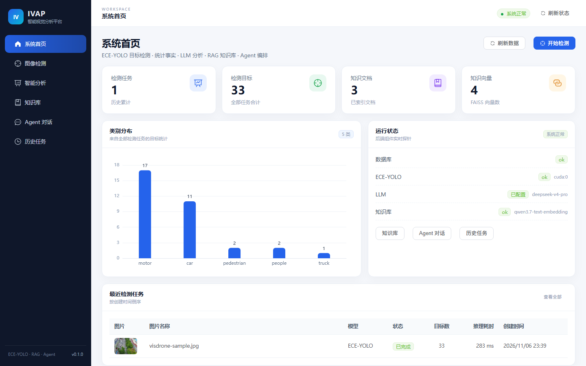
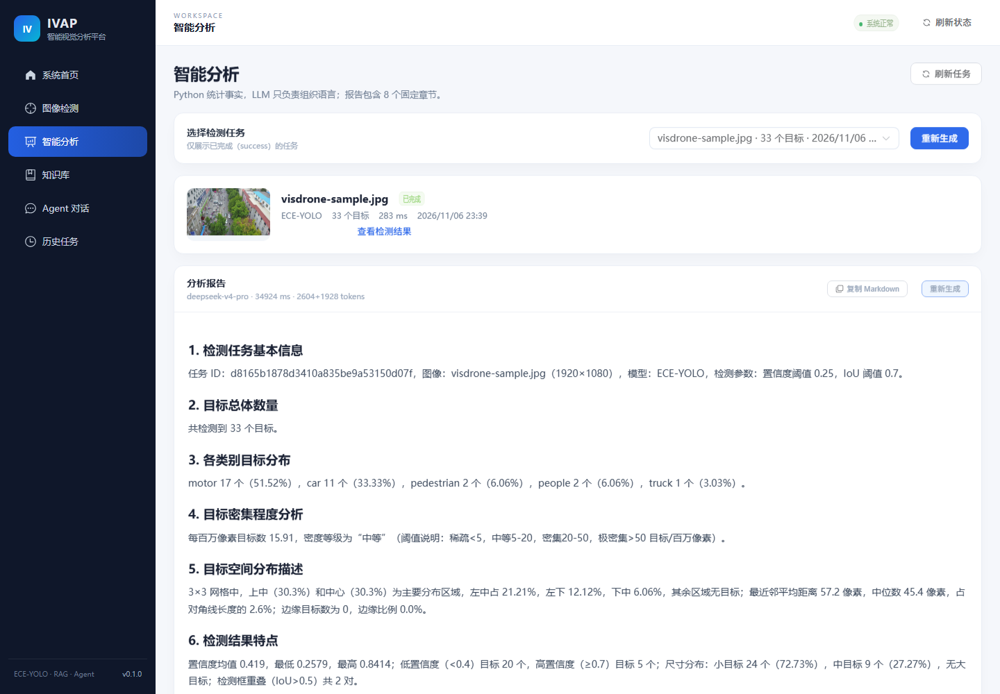
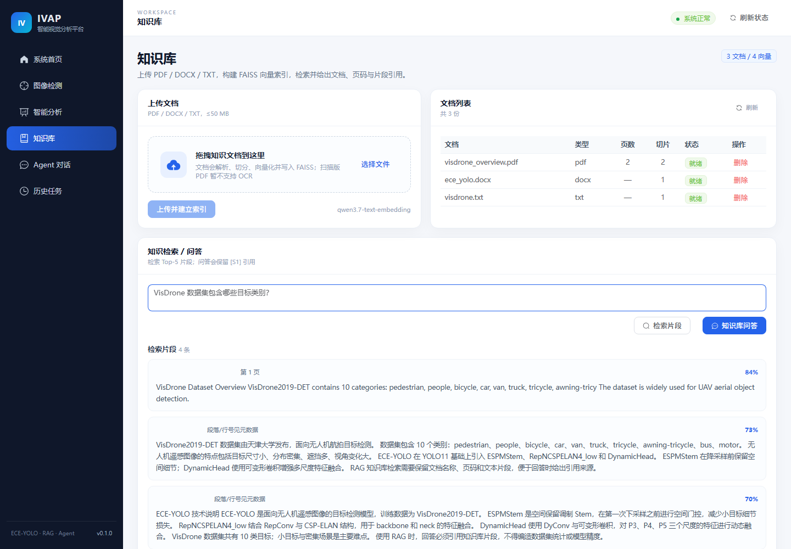
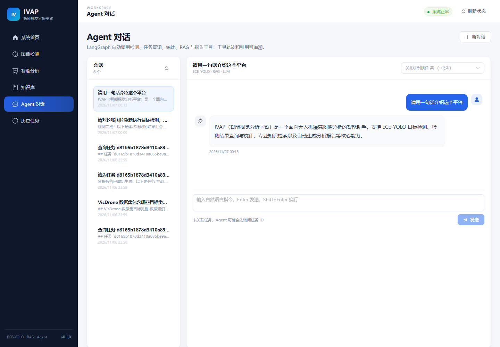
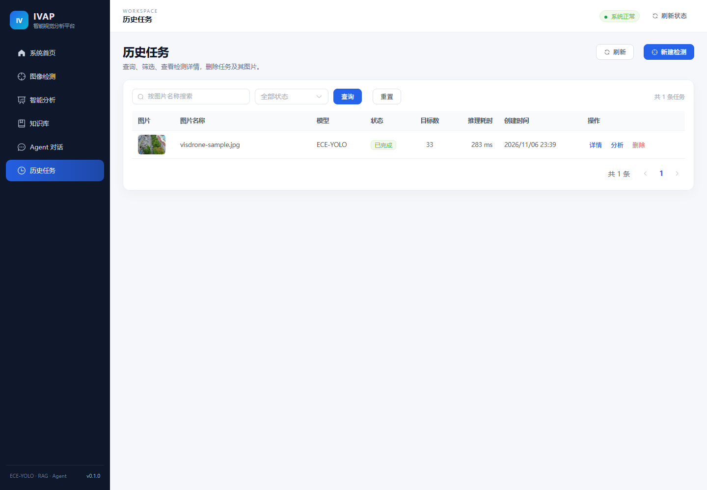

# 第七阶段实施报告（P7）

> 阶段：P7 Vue 3 前端
> 日期：2026-11-06 ～ 2026-11-07
> 结论：**通过**（6 个页面、真实 API 联调、生产构建成功、Chrome 无控制台错误）
> 设计：[01-architecture-design.md](01-architecture-design.md) §8
> 前置：[08-phase-6-report.md](08-phase-6-report.md)

---

## 1. 本阶段目标

1. Vue 3 + Vite 6 + Element Plus + Pinia + ECharts；
2. 6 个页面：首页、检测、分析、知识库、Agent、历史；
3. 检测结果图、类别图表、Markdown 报告、RAG 引用、工具轨迹；
4. Axios 统一错误处理，Vite 代理 `/api`、`/static`；
5. 生产构建 + 浏览器冒烟验证。

---

## 2. 技术栈与结构

| 组件 | 版本 |
|---|---|
| Vue | 3.5.13 |
| Vite | 6.0.7 |
| Element Plus | 2.9.7 |
| Pinia | 2.3.0 |
| Vue Router | 4.5.0 |
| Axios | 1.7.9 |
| ECharts | 5.6.0 |
| markdown-it / DOMPurify | 14.1.0 / 3.2.3 |

```text
frontend/src/
├── api/          # http / detection / analysis / knowledge / chat
├── components/   # Layout、上传、DetectionViewer、ClassBarChart、MarkdownView、
│                 # CitationList、ToolCallList、TaskTable、StatusTag、EmptyState
├── router/       # 6 个页面路由
├── stores/       # app / detection / knowledge / chat
├── views/        # 6 个页面
├── utils/        # 时间/状态/路径
└── assets/styles # 全局样式
```

---

## 3. 页面能力

| 页面 | 核心交互 |
|---|---|
| 首页 | 4 个统计卡片、类别分布图、组件健康状态、最近任务、快捷入口 |
| 图像检测 | 拖拽上传、模型选择、conf/iou 滑杆、结果图、类别图、目标明细、跳转分析/Agent |
| 智能分析 | 成功任务选择、生成/重新生成、8 段 Markdown、复制、Mock 提示 |
| 知识库 | 上传 PDF/DOCX/TXT、文档列表/删除、检索片段、知识库问答、引用 |
| Agent 对话 | 会话列表、任务/图片绑定、自然语言发送、工具轨迹、引用、Markdown |
| 历史任务 | 关键词/状态筛选、分页、详情抽屉、结果图、目标表、删除 |

---

## 4. 截图

### 首页



### 智能分析



### 知识库



### Agent 对话



### 历史任务



---

## 5. 构建结果

```text
vite v6.0.7 building for production...
✓ 2143 modules transformed.
dist/index.html                     0.85 kB
dist/assets/index-*.css           352.43 kB │ gzip: 49.73 kB
dist/assets/index-*.js             89.10 kB │ gzip: 32.93 kB
dist/assets/vue-*.js              105.28 kB │ gzip: 41.42 kB
dist/assets/markdown-*.js         113.82 kB │ gzip: 54.54 kB
dist/assets/charts-*.js           455.29 kB │ gzip: 152.88 kB
dist/assets/element-*.js          847.84 kB │ gzip: 273.35 kB
✓ built in 8.25s
```

通过 `manualChunks` 拆分 Vue / Element Plus / ECharts / Markdown，主包从 1.6 MB 降到 89 KB。

---

## 6. 浏览器冒烟验证

使用 **Chrome headless + puppeteer-core**，真实后端 + MySQL + Vite dev server。

### 6.1 检测 → 知识库 → Agent 历史

```text
detect: ok
knowledge: ok
agent history: ok
```

- 检测页上传 VisDrone 图，点击“开始检测”，等待“检测结果”，页面显示 33 个目标；
- 知识库输入 “VisDrone 数据集包含哪些目标类别？”，点击“检索片段”，出现 4 条来源；
- Agent 页点击历史会话，Markdown 消息与工具结果正常渲染。

首次脚本报告 1 个控制台 404，定位为缺少 favicon；已添加 `public/favicon.svg` 与 `<link rel="icon">`，复测为 0。

### 6.2 Agent 对话发送

```text
用户：请用一句话介绍这个平台
结果：assistant Markdown 正常返回
errors: 0
```

截图见上方 Agent 对话。

---

## 7. 联调细节

- `vite.config.js` 代理 `/api` 与 `/static` 到 `http://127.0.0.1:8000`；
- Axios 统一提取后端 `error.code/message/request_id`；
- 图片 URL 直接使用后端 `/static/...`；
- Markdown 经 `DOMPurify.sanitize` 后渲染，防 XSS；
- Mock 检测/报告/回答在页面上显示警告标签；
- 历史任务详情使用 `el-drawer`，不新增路由；
- Agent 选择任务后自动取 `image_url` 的受控相对路径，传给 detect_image。

---

## 8. 问题与处理

| 问题 | 原因 | 处理 |
|---|---|---|
| Vite dev 占用导致 `index.html`/`vite.config.js` 写入失败 | Windows 文件锁 | 停止 dev server 后修改，再重启 |
| 浏览器控制台 404 | 缺少 favicon | 增加 `public/favicon.svg` 与 link |
| 主包 1.6 MB | Element Plus/ECharts 全量 | `manualChunks` 拆分 |
| npm 11 提示 install-scripts 未审批 | npm 新版安全策略 | esbuild/vue-demi 构建仍正常；未改全局配置 |
| 截图时检测页仍显示 loading 遮罩 | 截图触发早于 `finally` 清 loading | 实际交互会立即清除；不影响功能 |

---

## 9. 验收清单

- [x] 6 个页面全部可访问
- [x] 首页统计/图表/最近任务
- [x] 检测上传、模型参数、结果图、类别图、明细
- [x] 分析任务选择、真实报告 Markdown、重新生成
- [x] 知识库上传/列表/删除/检索/问答/引用
- [x] Agent 会话、任务绑定、工具轨迹、引用、发送
- [x] 历史筛选、分页、详情抽屉、删除
- [x] Axios 联调与统一错误提示
- [x] 生产构建成功
- [x] Chrome headless 冒烟 0 控制台错误
- [x] 后端 45 个测试仍通过

---

## 10. 下一阶段（P8）

P8 将完成：

1. pytest 覆盖补齐 + 真实链路回归记录；
2. `backend/Dockerfile`、`frontend/Dockerfile`、`nginx.conf`；
3. `docker-compose.yml`（MySQL + backend + frontend），可选 GPU overlay；
4. 部署文档、环境变量说明、健康检查、数据卷；
5. 最终 README 汇总。

> 当前机器**未安装 Docker**。P8 可以先完成 Docker 文件与 Compose 配置，但 `docker compose up` 的真实验收需要安装 Docker Desktop（WSL2）或换一台有 Docker 的机器。P8 开始前会先确认这一点。
