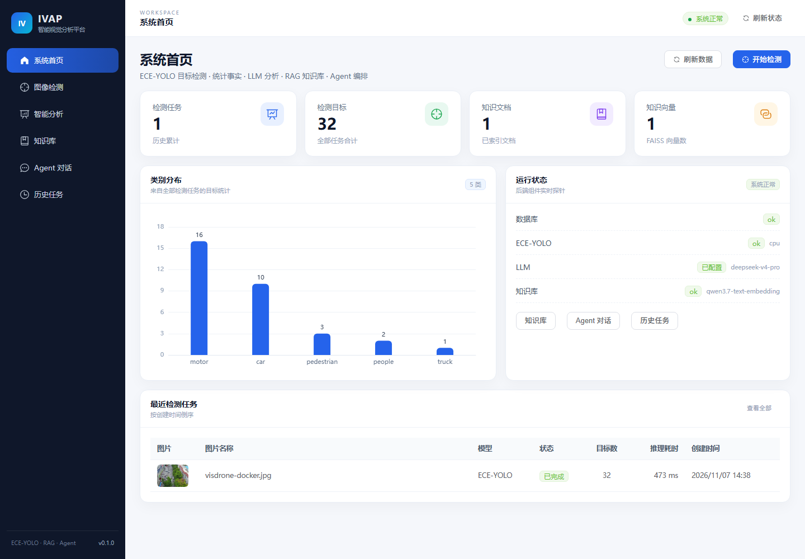
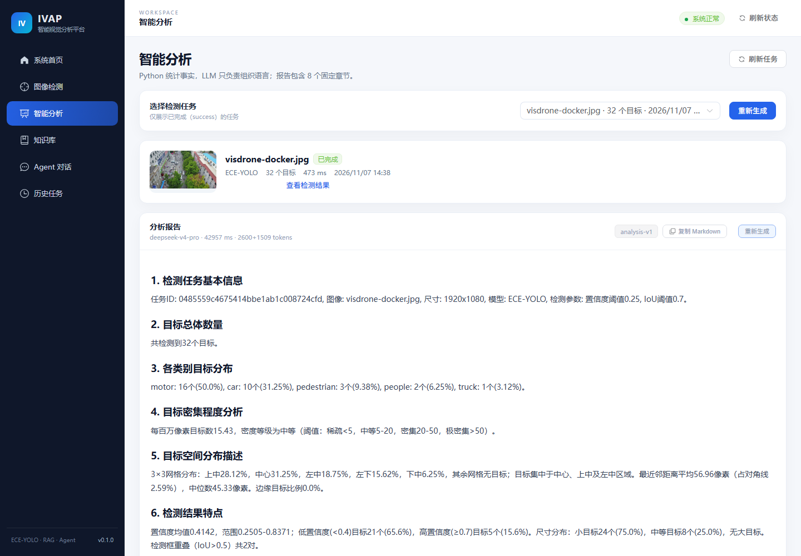

# 第八阶段实施报告（P8）

> 阶段：P8 测试、Docker 与部署
> 日期：2026-11-07
> 结论：**通过**（三容器 healthy；真实检测、RAG、Agent、分析报告、数据持久化全部验收）
> 部署指南：[10-deployment.md](10-deployment.md)
> 前置：[09-phase-7-report.md](09-phase-7-report.md)

---

## 1. 本阶段目标

1. Docker Desktop + WSL2 安装并配置到 D 盘；
2. 后端、前端、MySQL 三容器化；
3. Nginx 托管前端并反代 `/api`、`/static`；
4. `docker compose up` 一条命令启动；
5. CPU 默认可运行，GPU overlay 可选；
6. 真实检测、RAG、Agent、报告与数据卷持久化验收；
7. 最终测试、部署文档与 README。

---

## 2. Docker / WSL2 环境

| 项 | 结果 |
|---|---|
| Windows | Windows 10 Pro 22H2，build 19045 |
| 内存 / CPU | 15.77 GB / 12 线程 |
| Docker Desktop | **4.98.0** |
| 安装路径 | **`D:\Docker`** |
| WSL 数据盘 | **`D:\DockerData`** |
| WSL | 3.0.1.0，kernel 6.18.40.1-1，默认版本 2 |
| Docker CLI / Compose | 29.9.2 / v5.6.1 |
| `.wslconfig` | `memory=8GB`、`processors=8`、`swap=2GB` |
| Docker 服务 | `com.docker.service` Automatic / Running |

安装参数：

```text
install --quiet --accept-license --backend=wsl-2
  --installation-dir=D:\Docker
  --wsl-default-data-root=D:\DockerData
  --no-windows-containers
  --always-run-service
```

> Docker Hub 直连超时；通过 registry mirror 和 DaoCloud 预拉 MySQL 解决，详见部署指南第 9 节。

---

## 3. 交付文件

```text
backend/Dockerfile              # Python 3.9 + PyTorch CPU + ECE-YOLO
frontend/Dockerfile             # Node 22 构建 + Nginx 1.27
frontend/nginx.conf             # SPA / API / static 反代
docker-compose.yml              # mysql + backend + frontend
docker-compose.gpu.yml          # NVIDIA GPU overlay
.dockerignore
frontend/.dockerignore
.env.docker.example
scripts/docker_up.cmd
scripts/docker_down.cmd
scripts/docker_logs.cmd
docs/10-deployment.md
```

### 镜像

| 镜像 | 大小 |
|---|---:|
| `ivap-backend:latest` | 2.83 GB |
| `ivap-frontend:latest` | 76.2 MB |
| `mysql:8.0.28` | 693 MB |

后端 CPU 依赖固定为：

```text
torch 2.1.2+cpu
torchvision 0.16.2+cpu
numpy 1.26.4
opencv-python 4.11.0.86
ultralytics 8.3.209
faiss-cpu 1.9.0
```

> 构建时 `ultralytics` 曾把 NumPy 升到 2.0.2，已通过显式 pin 修复；镜像内验证全部 import 正常。

---

## 4. 启动与健康

命令：

```powershell
docker compose --env-file .env.docker up -d --build
```

结果：

```text
ivap-mysql     mysql:8.0.28        Up (healthy)   0.0.0.0:3307->3306
ivap-backend   ivap-backend:latest Up (healthy)   0.0.0.0:8000->8000
ivap-frontend  ivap-frontend:latest Up (healthy)  0.0.0.0:8080->80
```

- `alembic upgrade head` 在 backend 容器启动时自动执行；
- 模型从 `/app/best.pt` 加载，`device=cpu`，10 类；
- LLM `deepseek-v4-pro`、Embedding `qwen3.7-text-embedding` 真实可用；
- 前端 8080、后端 8000、Swagger `/docs` 均 200。

---

## 5. 真实链路验收

### 5.1 检测

```text
POST /api/v1/detection/predict
task_id: 0485559c4675414bbe1ab1c008724cfd
status: success
total_objects: 32
inference_time_ms: 473
class_statistics:
  motor 16, car 10, pedestrian 3, people 2, truck 1
is_mock: false
```

结果图通过 Nginx 访问：

```text
GET http://localhost:8080/static/results/2026/11/0485559c4675414bbe1ab1c008724cfd.jpg
→ 200 image/jpeg, 856,960 bytes
```

> CPU 结果 32 个，与宿主 GPU 的 33 个存在 1 个差异，属于设备/数值差异；同一模型、同一权重，非 Mock。

### 5.2 RAG

上传 `visdrone.txt`：

```text
document_id: 9f515a2c747c49d8829f78b42120f0e9
chunks: 1
status: ready
```

问答：

```text
问题：VisDrone 数据集包含哪些目标类别？
no_answer: false
is_mock: false
citations: 1
[S1] visdrone.txt  score=0.7317
```

回答正确列出 10 个类别并保留 `[S1]`。

### 5.3 Agent

```text
POST /api/v1/chat
message: 查询任务 0485... 的统计信息
tool: get_detection_statistics / success / 5 ms
answer: 32 个目标 + 5 类分布
is_mock: false
```

### 5.4 分析报告

```text
POST /api/v1/analysis/0485...
report_id: 1
latency_ms: 42957
usage: prompt 2600 + completion 1509
content: 8 段，1934 字符
is_mock: false
```

### 5.5 数据持久化

```powershell
docker compose down
docker compose up -d
```

重启后：

```text
检测任务仍在：32 个目标
报告仍在：report_id=1
知识文档仍在：1 份
```

---

## 6. 前端与 Nginx





Nginx 配置验证：

- `/` → SPA `index.html`；
- `/api/` → `backend:8000`；
- `/static/` → `backend:8000`，结果图 200；
- `/docs` → `backend:8000`，Swagger 200；
- `client_max_body_size 50m`；
- `/healthz` 容器健康检查。

---

## 7. 资源实测

| 组件 | 常驻内存 |
|---|---:|
| `ivap-backend` | 349–446 MB |
| `ivap-mysql` | 358–405 MB |
| `ivap-frontend` | 8–10 MB |
| Docker WSL2 VM（空闲） | 约 1.7 GB |
| 宿主机空闲（三容器运行） | 约 4.3 GB |

比预估的 3.5–5.5 GB 更低；16 GB 机器足够，构建阶段需要更多内存，已用 8 GB WSL 上限。

---

## 8. 测试与检查

```text
backend pytest: 45 passed in 45.46s
ruff:            All checks passed
pip check:       No broken requirements
alembic check:   No new upgrade operations detected（容器内）
compose config:  通过
container health: 三容器 healthy
```

镜像内 import 验证：

```text
torch 2.1.2+cpu
torchvision 0.16.2+cpu
numpy 1.26.4
cv2 4.11.0
ultralytics 8.3.209
faiss 1.9.0
cuda False
```

---

## 9. 遇到的问题与处理

| 问题 | 原因 | 处理 |
|---|---|---|
| Docker Hub 拉取超时 | 国内网络 | `daemon.json` 增加 `https://docker.1panel.live` |
| MySQL 层从 1panel 超时 | 大层下载中断 | DaoCloud 拉取后 `docker tag ... mysql:8.0.28` |
| PyTorch 官方源卡住 | download.pytorch.org 不可达/慢 | 改用阿里云 wheel 直链 |
| PyPI 安装慢 | 官方源 | 清华 PyPI 镜像 |
| NumPy 被升到 2.0.2 | ultralytics 依赖解析 | 固定 `numpy==1.26.4`、`opencv==4.11`、`ultralytics==8.3.209` |
| WSL 内核缺失 | 旧 inbox WSL | `wsl --update --web-download` → 3.0.1.0 |
| 构建后宿主内存紧张 | WSL 8GB + build cache | `docker builder prune`、`wsl --shutdown` 后重启 |
| `--progress` 参数警告 | Compose 全局 flag | 使用 `docker compose --progress plain build` |

---

## 10. 验收清单

- [x] Docker Desktop 4.98 安装到 D 盘
- [x] WSL2 3.0.1 + 自定义数据盘 `D:\DockerData`
- [x] 8GB / 8 核 / 2GB swap 限制
- [x] backend / frontend / MySQL 三容器
- [x] 三容器 healthy
- [x] Nginx SPA、API、static、Swagger 全通
- [x] CPU 真实 ECE-YOLO 检测（32 目标 / 473ms）
- [x] 真实 RAG 上传与带引用回答
- [x] 真实 Agent 工具调用
- [x] 真实 8 段分析报告（42.96s）
- [x] 数据卷重启后持久化
- [x] 镜像 import 验证
- [x] 45 个后端测试 + ruff + alembic check
- [x] 部署文档、`.env.docker.example`、启动/停止脚本

---

## 11. 已知限制

1. **GPU overlay 未做运行验收**：本机 Docker Desktop 未启用 NVIDIA WSL GPU；`docker-compose.gpu.yml` 已提供，但本次只验证 CPU 路径。
2. **单 worker**：模型、FAISS 在进程内，不能直接水平扩展。
3. **MySQL 镜像本地 tag**：`mysql:8.0.28` 来自 DaoCloud，重新部署时需按部署指南配置 mirror 或预拉取。
4. **国内镜像 URL 写在 `.env.docker`/Dockerfile 默认值**：海外环境需换成官方源。
5. **端口 3307/8000 暴露在宿主机**：生产环境应收紧。
6. **测试数据保留在 Docker 卷中**：当前任务 `0485...`、报告 1、知识文档 1 份；如需干净环境用 `docker compose down -v`（会删数据）。

---

## 12. 最终状态

```text
P1–P8：全部完成
后端：45 tests passed
前端：生产构建 + Docker/Nginx
容器：3/3 healthy
访问：http://localhost:8080
```

项目已达到“可运行、可演示、可部署、可复现”的交付状态。
